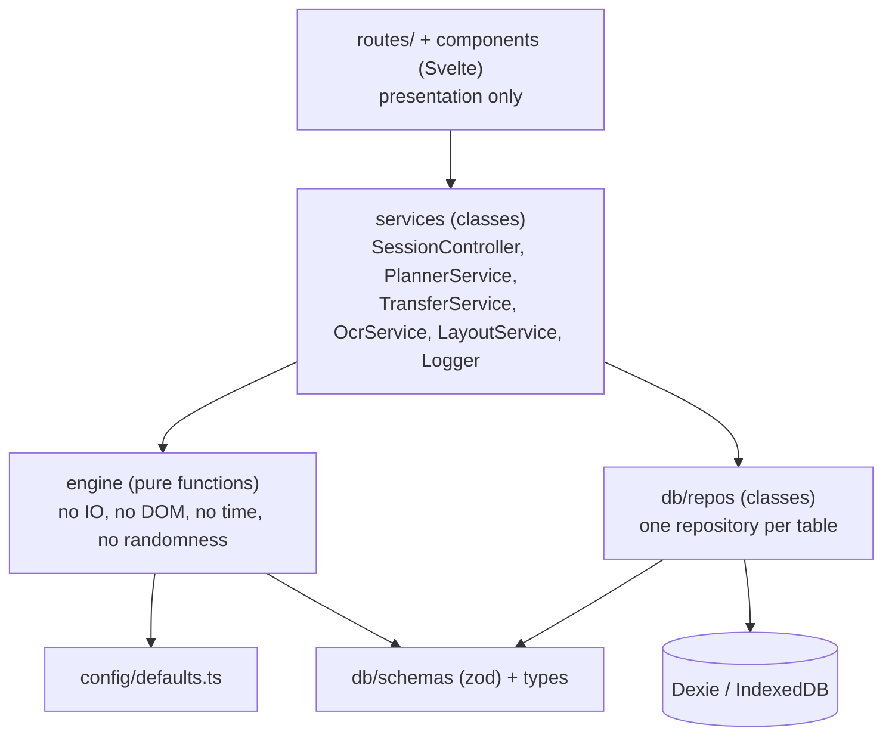

# Build Plan — Snowpack: Study & Cram

This is the **how**. The look and feel is in `docs/DESIGN.md`. The **what and why** is in `docs/CONCEPT.md` (section numbers below refer to it). When the two disagree, the concept wins and this plan gets fixed.

---

## 0. Principles (non-negotiable)

1. **Full engine in v1. No stubs.** Every algorithm in the concept ships in v1. A phase is done only when its pieces are complete _and tested_. Only things that don't touch the core stay out (audio, sync server, calendar import, learned reminder times, ILP optimiser — concept §20).
2. **The engine is pure TypeScript.** No DOM, no network, no `Date.now()` inside logic (time is passed in), no unseeded randomness. Every engine module is unit-tested in Vitest.
3. **One source of truth.** Reviews are an **append-only event log**. All scheduler state on a card (FSRS state, status, fragile flag, criterion progress) is a **cache rebuilt by replaying events**. Content (courses, topics, chunks, notes, cards) is merged **last-write-wins** with tombstones.
4. **Deterministic.** FSRS fuzz off. Ties broken by ID. Any shuffle (option order, distractors) uses a seeded RNG keyed by `(cardId, sessionId, attempt)`. Replaying the same events always gives the same state.
5. **Every tunable number lives in `src/lib/config/defaults.ts`** (§13). No magic numbers in code.
6. **Offline-first.** Nothing in a study session waits on the network.
7. **Fast on 3G.** App shell is small; heavy libraries (OCR, ELK, Svelte Flow) are lazy-loaded on the routes that need them, and OCR + layout run in Web Workers.
8. **Tests run continuously and leave a trail.** Tests run on save, on commit, on push and in CI; every run writes reports to `test-results/`; the app keeps its own local log so behaviour can be explained after the fact (§11).

---

## 1. Stack

| Concern                    | Choice                                                            | Notes                                                                           |
| -------------------------- | ----------------------------------------------------------------- | ------------------------------------------------------------------------------- |
| Language                   | TypeScript (`strict`)                                             |                                                                                 |
| Framework                  | SvelteKit + Svelte 5 (runes)                                      | `adapter-static`, SPA mode (`ssr = false`, `fallback: 'index.html'`)            |
| Storage                    | IndexedDB via **Dexie**                                           | `liveQuery` for reactive UI                                                     |
| Scheduler                  | **ts-fsrs**                                                       | Fuzz off; day-based intervals (see §6.2)                                        |
| FSRS personal optimisation | **fsrs-rs via WASM** (`fsrs-browser`)                             | Verify package availability at setup; fall back to default params if absent     |
| Validation                 | **zod**                                                           | Import text AST, export/import files                                            |
| Zip                        | **fflate**                                                        | Export/import `.zip`                                                            |
| Structured diagrams        | **@xyflow/svelte** (Svelte Flow) + **elkjs**                      | ELK runs in a Web Worker                                                        |
| OCR                        | **tesseract.js**                                                  | Web Worker; English data cached by the service worker                           |
| Drag & drop                | Own small pointer-events module (preferred)                       | Must work with touch; `svelte-dnd-action` only if confirmed Svelte 5 compatible |
| PWA                        | **@vite-pwa/sveltekit** (Workbox)                                 | Precache shell, runtime-cache lazy chunks + OCR data                            |
| IDs                        | `crypto.randomUUID()`                                             | Globally unique from day one                                                    |
| Tests                      | **Vitest** (unit + sim), **Playwright** (e2e, mobile viewport)    | Coverage via `@vitest/coverage-v8`                                              |
| Continuous testing         | **GitHub Actions** CI + **simple-git-hooks** with **lint-staged** | Hooks on commit/push; CI on every push and PR                                   |
| Lint/format                | ESLint + Prettier + `svelte-check`                                |                                                                                 |
| Hosting                    | Cloudflare Pages (static)                                         | HTTPS required for service workers                                              |
| Icons                      | **lucide-svelte**                                                 | Tree-shaken, 2 px rounded stroke                                                |
| Fonts                      | Nunito (variable) + Caveat, self-hosted subset `woff2`            | Caveat lazy-loaded (DESIGN §3.2)                                                |

Do **not** add: React, three.js, a server, an AI SDK.

---

## 2. Project structure

```
src/
  lib/
    config/defaults.ts        # every tunable number (§13)
    design/tokens.css         # colour, type, spacing, motion tokens (DESIGN §3) + tokens.ts mirror
    ui/                       # shared components (DESIGN §5); ui/yuki/ = the companion
    db/
      schema.ts               # Dexie tables + indexes
      schemas/                # one zod schema per entity; types = z.infer (mirrors DATA_MODEL.md)
      repos/                  # one repository class per table: typed reads, LWW writes, tombstones
    engine/                   # PURE — no DOM, no IO
      time.ts                 # day index with rollover hour
      rng.ts                  # seeded RNG
      fsrs.ts                 # ts-fsrs wrapper, rating map, retrievability
      cardgen.ts              # note -> card variants + format paths
      criterion.ts            # 3-then-1, recall-weighted rule
      status.ts               # card status state machine
      queue.ts                # session queue + reinsertion lags
      session.ts              # phases, fixed format paths, redo-till-right
      cram.ts                 # triage, gaps, final pass, fragile cap
      acquisition.ts          # chunk flow, ordering, split flags, paths
      onenight.ts             # one-night triage plan
      planner.ts              # workload, feasibility, knapsack, least-laxity
      answers.ts              # the text answer of each card variant
      grading.ts              # normalise, Damerau-Levenshtein, collision guard, accept check
      grading-shapes.ts       # hit test, sequence LIS feedback, edge set diff
      distractors.ts          # sibling selection + ranking + first-letter bank
      replay.ts               # events -> card caches
      merge.ts                # union events, LWW content
    import/
      lexer.ts parser.ts      # text -> AST (line-numbered errors); block-parsers, compare-parser, diagram-parser
      ast.ts                  # zod schemas for the parsed blocks
      build.ts                # AST -> topics/chunks/notes/cards, as a plan with no storage
      zip.ts                  # .zip with text + images
      image-size.ts prompt.ts # resize rule; the chatbot prompt, verbatim
    transfer/
      export.ts import.ts     # scoped zip export/import, replace/merge
    diagrams/
      occlusion/              # editor, overlay, ocr.worker.ts
      structured/             # model, elk.worker.ts, Svelte Flow views
    exercises/                # one Svelte component per exercise kind
    pwa/                      # persistence, storage estimate, update prompt
    log/                      # app logger, IndexedDB ring buffer, error capture
  routes/
    +page.svelte              # Today
    course/[id]/              # course overview, topics, placement
    import/                   # paste text + attach images/zip, preview, commit
    study/[sessionId]/        # session runner
    planner/                  # exams, availability calendar, shortfall
    diagram/[noteId]/edit/    # occlusion or structured editor
    settings/                 # all toggles, export/import, offline switch
    dev/ui/                   # style guide: every component, state, theme and Yuki state (dev only)
tests/
  unit/  sim/  e2e/  golden/
  sim/scenarios/              # named scenarios (e.g. four-exams-one-week.ts)
scripts/
  test-summary.ts             # merges reports into test-results/summary.md
  bundle-check.ts             # fails if the shell exceeds SHELL_JS_BUDGET_KB
  stub-check.ts               # fails if "not implemented" remains anywhere in src/
.github/workflows/ci.yml
test-results/                 # gitignored; written by every test run
docs/
  CONCEPT.md  BUILD_PLAN.md  DATA_MODEL.md  DESIGN.md  erd.png  PROGRESS.md
  design/wolf.svg  design/wolf-preview.html   # Yuki reference art and animation states
.claude/agents/
  spec-test-writer.md         # writes tests from the spec before implementation
  reviewer.md                 # read-only review at the end of each phase
```

---

## 3. Data model

> **`docs/DATA_MODEL.md` is authoritative** for every table, field, payload, enum and the export format, and has the ER diagram. This section is a summary.

### 3.1 Dexie schema

```ts
db.version(1).stores({
	courses: 'id, status, examDate, updatedAt',
	topics: 'id, courseId, [courseId+order], updatedAt',
	chunks: 'id, topicId, [topicId+order], updatedAt',
	notes: 'id, courseId, topicId, chunkId, type, updatedAt',
	cards: 'id, noteId, courseId, status, due, updatedAt',
	events: 'id, ts, cardId, sessionId, type, [cardId+ts]',
	media: 'id, hash',
	sessions: 'id, startedAt, mode',
	kv: 'key', // settings, availability, deviceId, seq, lastExportAt, schemaVersion, fsrsParams, calibration
	logs: '++seq, ts, level, area', // app log ring buffer (local)
});
```

### 3.2 Types (abbreviated — full definitions in `DATA_MODEL.md`, implemented as zod schemas in `db/schemas/`)

```ts
type ID = string; // crypto.randomUUID()
interface Meta {
	id: ID;
	createdAt: number;
	updatedAt: number;
	deviceId: ID;
	deleted?: true;
}

interface Course extends Meta {
	name: string;
	status: 'active' | 'archived';
	examDate?: string;
	examTime?: string; // local 'YYYY-MM-DD', 'HH:mm'
	examFormat: 'recall' | 'recognition' | 'mixed';
	color: 'lavender' | 'peach' | 'sage' | 'sky' | 'rose' | 'butter';
}
interface Topic extends Meta {
	courseId: ID;
	name: string;
	order: number;
	placement: 'unread' | 'read';
	priority: 'high' | 'normal';
}
interface Chunk extends Meta {
	topicId: ID;
	order: number;
	text: string;
	words: number;
	source: 'notes' | 'generated';
	splitFlag?: true;
}

type NoteType =
	| 'keyterm'
	| 'fact'
	| 'cloze'
	| 'sequence'
	| 'compare'
	| 'scenario'
	| 'example'
	| 'diagram'
	| 'occlusion';
interface Note extends Meta {
	courseId: ID;
	topicId: ID;
	chunkId?: ID;
	type: NoteType;
	payload: NotePayload;
	priority: 'high' | 'normal';
	tags: string[];
	generated: boolean;
	check: boolean;
	accept: Record<string, string[]>; // grow-as-you-go accept list per answer key
}

interface Card extends Meta {
	noteId: ID;
	courseId: ID;
	variant: string; // e.g. 'fwd','rev','c1','row:2:col:1','edge:<id>','box:<id>','step:4'
	path: ExerciseKind[]; // fixed format path (no random formats)
	suspended: boolean;
	// ---- caches, rebuilt by replay ----
	fsrs: FsrsCardState | null;
	due?: number;
	status: CardStatus;
	fragile: boolean;
	weak: boolean;
	daysCorrect: number;
	pathStep: number;
	accuracy: { n: number; correct: number };
}
type CardStatus =
	| 'unseen'
	| 'learning'
	| 'needs-work'
	| 'provisional'
	| 'exam-ready'
	| 'secure'
	| 'one-night';

type Mode = 'acquisition' | 'cram' | 'longterm' | 'onenight';
interface ReviewEvent {
	id: ID;
	ts: number;
	deviceId: ID;
	seq: number;
	type: 'review';
	cardId: ID;
	sessionId: ID;
	mode: Mode;
	kind: ExerciseKind;
	weight: 'full' | 'recognition' | 'none';
	firstAttempt: boolean; // first attempt at this card in this session
	correct: boolean;
	responseMs: number;
	credited: boolean; // false for same-day acquisition chunk-quiz answers
	chosen?: string;
	chosenFromCardId?: ID; // logged confusion (wrong pick)
	answerText?: string; // typed answer, for accept-list review
}
// other event types: 'pretest' (never affects scheduling), 'selfRated' (self-rated lane),
// 'acceptAdded' (synonym added to accept list)
```

**Content vs. caches.** Courses/topics/chunks/notes/cards structure are content (merged LWW by `updatedAt`, then `deviceId`). Everything marked "cache" is recomputed by `replay()` and never merged directly.

### 3.3 Exercise kinds and weights

| Kind                                                                                                                                | Group               | Weight               |
| ----------------------------------------------------------------------------------------------------------------------------------- | ------------------- | -------------------- |
| `cloze`, `firstLetterType`, `fadeStep`, `newInstance`                                                                               | Recall              | full                 |
| `sequence`, `parsons`, `subgoalMatch`, `occlusionType`, `occlusionDrag`, `structureRebuild`, `layerOrder`, `nodeCloze`, `edgeCloze` | Arrange / Recall    | full                 |
| `categorize`, `oddOneOut`, `whichOne`, `scenario`, `tableRow`, `pickPrinciple`                                                      | Sort & discriminate | full                 |
| `mc`, `multiSelect`, `occlusionBank`, `firstLetterBank`                                                                             | Choose              | recognition          |
| `matching`, `hotspot`, `pretest`                                                                                                    | Warm-up             | none                 |
| `flip`, `explainIt`, `blurt`, `redraw`, `exampleStudy`                                                                              | Self-rated          | none (separate lane) |

True/false is not implemented.

---

## 4. Import format

### 4.1 Grammar

Plain UTF-8 text, line-based. Blank lines ignored. A line starting with `@` opens a block; other lines belong to the current block.

| Directive                | Meaning                                                                             | Line syntax inside                                                 |
| ------------------------ | ----------------------------------------------------------------------------------- | ------------------------------------------------------------------ |
| `@deck <name>`           | Selects/creates a **Topic** in the course chosen on the import screen               | —                                                                  |
| `@tag <name>`            | Sticky tag for following notes                                                      | —                                                                  |
| `@priority high\|normal` | Sticky priority                                                                     | —                                                                  |
| `@keyterms`              | Pre-training notes for the current chunk                                            | `term :: short meaning`                                            |
| `@read`                  | Starts a **new chunk**; following cards attach to it until the next `@read`/`@deck` | free text; `[GENERATED]` prefix → `source:'generated'`             |
| `@fact`                  | Fact notes                                                                          | `term :: definition`                                               |
| `@cloze`                 | Cloze notes                                                                         | sentence with one or more `{{answer}}` → variants c1, c2…          |
| `@sequence <name>`       | Ordered steps                                                                       | one step per line                                                  |
| `@compare`               | Comparison table                                                                    | Markdown-style rows `\| attr \| A \| B \|`; first row = item names |
| `@scenario`              | Scenario cards                                                                      | `situation :: answer`                                              |
| `@example <name>`        | Worked example                                                                      | `subgoal label :: step`                                            |
| `@diagram stack <name>`  | Layered diagram                                                                     | `layer :: role`, top to bottom                                     |
| `@diagram flow <name>`   | Box-and-arrow diagram                                                               | `A -> B : label` (label optional)                                  |
| `@occlusion <file>`      | Occlusion card from an attached image                                               | — (boxes from OCR/editor)                                          |
| `@coverage`              | Section list from the chatbot                                                       | comma-separated; shown in preview, not stored as cards             |

Any line ending in `[CHECK]` sets `check: true` (strip the marker). Unknown directives and malformed lines become **errors with line numbers**; the preview screen shows them and lets valid blocks import. Commit runs in one Dexie transaction (all-or-nothing for the valid set).

Details of the grammar (reasons in the Decisions log):

- **Separators:** `::` needs a space on each side and splits on the first one, so `std::vector :: a growable array` works.
- **`@deck`** resets `@tag` and `@priority`, and closes the current chunk. Naming a deck again in the same file adds to it. Everything except `@coverage` needs a `@deck` before it.
- **`@keyterms`** attaches to the `@read` that comes next, if only `@tag`, `@priority` or more `@keyterms` come between; otherwise to the current chunk.
- **Bad lines:** in a one-note-per-line block (`@keyterms`, `@fact`, `@cloze`, `@scenario`) a bad line drops only that line. In a one-note block (`@compare`, `@example`, `@diagram`) it drops the whole note, since a partial table or diagram would teach something wrong.
- **`@compare`** ignores the first row's corner cell, skips Markdown separator rows, and doesn't need a closing `|`.
- **`@diagram`** accepts a `source: <file>` line naming the image it was drawn from. A stack's `:: role` is optional.

### 4.2 Images and zips

The import screen accepts pasted text **plus** attached images (file picker, paste, camera via `<input type="file" accept="image/*" capture>`), or a `.zip` containing one `.txt` and its images. `@occlusion` and diagram source lines reference images by file name. Images are resized to max 1600 px on the long side, re-encoded as WebP, hashed (SHA-256) for de-duplication, and stored in `media`.

### 4.3 The chatbot prompt (ship verbatim in the app's import screen with a copy button)

```
You convert my lecture notes into import-ready study cards in a strict
format. Completeness and accuracy matter more than brevity.

INPUTS
- My lecture notes (required).
- Optionally my syllabus, past papers, or a line like "exam focus: X, Y".
  If given, use them to set priority.

COVERAGE
- Work through the notes section by section, in order. Skip nothing.
- One card per distinct testable unit: every definition, term, named
  theorem/law, process step, property, distinction, cause/effect.
- Do not summarize detail away; do not merge separate facts.
- Use ONLY what is in my notes (and syllabus/papers). Add no outside
  knowledge and invent no examples.
- If something is unclear, still make the card and append " [CHECK]".
- Drop exact duplicates; keep distinct-but-similar cards.

GROUPING
- Use my notes' own headings: top-level topic -> @deck, sub-topic -> @tag.
- Keep each card under the section it came from.

DECOMPOSITION (one topic -> several cards)
- A process: a @sequence for the order AND @fact/@cloze for what defines
  each stage AND @compare/@scenario for how adjacent stages differ.
- A comparison: a @compare table AND @scenario cards (situation -> which).
- A multi-part definition: one @cloze per part, not one long card.
- A diagram (in my notes or a screenshot I attach): a @diagram block,
  one arrow per line as A -> B : label. Never invent nodes or arrows
  you can't see; append [CHECK] if a label is unreadable.

CHUNKS (for learning from cold)
- Split the notes into chunks of one idea each (about 150-400 words).
- For each chunk output, in order: @keyterms (the terms to learn first),
  @read (the chunk text, in clear sentences), the cards that test it,
  and for a procedure one @example as "subgoal label :: step" lines.

IF I GIVE YOU NO NOTES (only a syllabus, topic list or past papers)
- Stay strictly within what those sources name. Start every generated
  @read with [GENERATED] so I know to check it against my course.

PRIORITY
- With a syllabus/past paper/exam focus: matching cards -> @priority high.
- Otherwise infer: anything defined, named, bolded, repeated, or listed
  as a rule -> high; supporting detail -> normal.

OUTPUT
- Output ONLY the format below, no commentary, except the final @coverage.
- End with @coverage and the list of section headings you processed, so
  I can confirm nothing was missed.

FORMAT
@deck <topic>
@tag <subtopic>
@priority high|normal
@fact
term :: concise definition (paraphrased)
@cloze
sentence with the key term in {{ }}
@sequence <name>
step
@compare
| | A | B |
| attribute | value | value |
@scenario
situation :: correct answer
@diagram stack <name>      (one layer per line, top to bottom)
layer :: role
@diagram flow <name>       (one arrow per line)
A -> B : arrow label
@keyterms
term :: short meaning
@read
chunk text
@example <name>
subgoal label :: step
@coverage
<section>, <section>, ...

Here are my notes:
[paste]
```

---

## 5. Card generation (note → cards, fixed paths)

| Note          | Cards (variants)                                   | Path (in order)                                                                                |
| ------------- | -------------------------------------------------- | ---------------------------------------------------------------------------------------------- |
| keyterm       | `fwd`                                              | `mc → cloze` (pre-training)                                                                    |
| fact          | `fwd` (term→def), `rev` (def→term)                 | `mc → cloze`                                                                                   |
| cloze         | one per `{{}}`                                     | `cloze` (first-letter fallback after a miss, §6.10)                                            |
| sequence      | `seq` + `step:i` (what comes after step i, 0-based) | `sequence → parsons`; step cards `whichOne → cloze`                                            |
| compare       | `row:r` per row, `cell:r:c` per cell, `which:r`    | `tableRow`, `cloze`, `whichOne → scenario`; `pickPrinciple` fires after a set                  |
| scenario      | `fwd`                                              | `scenario` (options = table items / sibling answers)                                           |
| example       | `ex`                                               | `exampleStudy → fadeStep(1..n, backward) → newInstance`; `subgoalMatch`; `parsons` as fallback |
| diagram stack | `layers`, `layer:<id>`                             | `layerOrder`; `nodeCloze`                                                                      |
| diagram flow  | `node:<id>`, `edge:<id>`, `rebuild`                | `nodeCloze`, `edgeCloze`, `structureRebuild`                                                   |
| occlusion     | `box:<id>`                                         | `occlusionBank → occlusionType/occlusionDrag`                                                  |

`mc`/`occlusionBank` steps are offered only while the card's accuracy is below `MC_UNTIL_ACCURACY` (0.75); above it the path jumps to the recall step.

---

## 6. Engine specifications

Each subsection is one pure module with unit tests. "Done when" lines are the acceptance checks.

### 6.1 Time (`time.ts`)

- A study **day** runs from `DAY_ROLLOVER_HOUR` (04:00) to the next 04:00, local time, so late-night study counts for the previous day.
- `dayIndex(ts)`, `daysBetween(a, b)`, `isSameStudyDay(a, b)`. All engine functions take `now` as an argument.

### 6.2 FSRS (`fsrs.ts`)

- `fsrs(generatorParameters({ request_retention: RETENTION, enable_fuzz: false, enable_short_term: false, maximum_interval }))` — confirm exact parameter names against the installed ts-fsrs version. Short-term steps are off because our session runner handles same-day repetition.
- **Only the first attempt at a card in a session is an FSRS review.** Later attempts in that session are logged but don't touch FSRS.
- **Rating map (auto-graded, deterministic):** first-attempt correct with `weight:'full'` → `Good`; correct with `weight:'recognition'` → `Hard`; wrong → `Again`. `Easy` is never auto-assigned in v1. `weight:'none'` events never reach FSRS.
- `retrievabilityAt(card, t)` via the library's retrievability function — used by cram triage and the planner.
- **Optimisation:** once `FSRS_OPTIMISE_MIN_REVIEWS` (1000) reviews exist, run the optimiser in a worker, store `{params, version}` in `kv`, and replay. Until then, default params.

### 6.3 Criterion (`criterion.ts`)

- **First credited session** for a card (any mode) needs `CRITERION_FIRST` (3) counting corrects, reduced to `CRITERION_FIRST_REDUCED` (2) when either holds (adaptive first-session criterion):
  - **Relearning will follow:** the session is `longterm` mode, or the plan has at least `RELEARN_OVERRIDE_SESSIONS` (3) relearning sessions for the card before the exam (relearning override: Vaughn, Dunlosky & Rawson 2016; Rawson & Dunlosky 2011; see the Decisions log).
  - **Known on first try:** the card's very first attempt ever was correct (a `full` or `recognition` answer) and it had no pretest before it. When that first attempt happens inside the session, the criterion drops to 2 right after it.
- **Later sessions** need `CRITERION_LATER` (1). Acquisition chunk-quiz sessions give no credit, so for a card handed off by acquisition the next-day retest is its first credited session.
- Each review event records the card's `required` count after that answer, so replay uses exactly what the session asked for (the plan's relearning count isn't in the event log otherwise).
- Counting corrects: first attempts after each reinsertion with `weight` `full` or `recognition`.
- **Recall-weighted:** the criterion is met only if the **last** counting correct was `weight:'full'`.
- A wrong answer resets that card's count for the session.
- `none`-weight kinds never count. Self-rated events never count.
- _Done when:_ tests cover MC-only streaks not meeting criterion, reset on error, and the full-weight-final rule.

### 6.4 Session queue (`queue.ts`, `session.ts`)

- **Reinsertion lags** (`LAGS`): after a correct on a new card, reinsert at 5, then 10, then 20 cards (done at 3 counting corrects). After an error, reinsert at 3 and reset. Relearning cards: done after 1 correct; a failure reinserts at 3, requires 1 correct, and sets `weak = true` (its next cram gap becomes 1 day). If the queue is shorter than the lag, append to the end.
- **Redo-till-right:** on a wrong first try, show the answer with contrastive feedback, then make the student clear it (options reshuffled with a new seed). Only the first attempt is logged as the counting event; the clear-it attempts are logged with `firstAttempt:false`.
- **Contrastive feedback:** when the student picked a distractor that came from another card, show both cards' texts side by side ("You chose _X_ — that's the definition of _Y_").
- **Phases, not shuffle:** a session is ordered warm-up → new material → recall drilling → discrimination → cleanup (concept §6). Within a phase the format is stable; confusable cards (same `compare` note or logged confusion pair) are placed **adjacently** in the discrimination phase.
- **No skip.** There is no "I know this" action anywhere.
- Session state (queue, counts) is persisted after every answer so a closed tab resumes exactly.
- **Rounds:** a session runs in rounds of at most `ROUND_WORKING_SET` (8) cards in play, taken in plan order (phases flow across rounds). A round ends when all its cards meet the criterion, or, at the first answer that leaves no card mid-redo, after `ROUND_MAX_ANSWERS` (40) answers or `ROUND_MAX_MINUTES` (8) minutes. Unfinished cards carry over to the front of the next round with their counts; lags reinsert within the round (a shorter round appends). After each round a **round summary** offers **Continue**, **Take a break** and **Stop here**. Once `BREAK_SUGGEST_AFTER_MIN` (25) minutes have passed since the session started or the last break ended, the summary suggests a `BREAK_MIN` (5)-minute break. It is only a suggestion: never forced, never a lock (CLAUDE.md rule 11). Stop here ends the session and keeps all progress.
- **Progress dots:** the current item carries the card's counting corrects and its `required` count, shown as dots on the exercise card (DESIGN §5).

### 6.5 Status (`status.ts`)

`daysCorrect` = number of distinct study days with a counting first-attempt correct since the last lapse.

| Status        | Rule                                                                                                       |
| ------------- | ---------------------------------------------------------------------------------------------------------- |
| `unseen`      | never studied                                                                                              |
| `learning`    | met in acquisition today; label **"New — retest tomorrow"**                                                |
| `needs-work`  | last first attempt on a later day was wrong (lapse → `daysCorrect = 0`)                                    |
| `provisional` | `daysCorrect = 1`                                                                                          |
| `exam-ready`  | `daysCorrect ≥ 2` and last review correct                                                                  |
| `secure`      | FSRS stability ≥ `SECURE_STABILITY_DAYS` (21), `fragile = false`, last review correct                      |
| `one-night`   | studied only in one-night mode; label **"One-night triage"**; never `exam-ready` until a later-day correct |

`secure` overrides `exam-ready` when its rule holds.

### 6.6 Cram (`cram.ts`) — concept §7

- **Triage:** `R_exam` = retrievability at exam time with no further review. `R_exam ≥ SECURE_AT_EXAM` (0.95) → secure (final pass only); otherwise at-risk; never reviewed → new.
- **Feasibility:** via `planner.ts` (§6.9). If short: degrade in order — criterion 3 → 2, then reduce relearning sessions `K`, then defer lowest value-per-minute new cards (knapsack). Always shown to the student.
- **New cards:** `new_per_day = ceil(N_new / max(1, D − 1))`, also capped so new-card trials stay under `NEW_SHARE_MAX` (0.5) of a session. Introduced in the evening session; none after the evening of day D−2 when D ≥ 3; none on exam day.
- **Queue order:** priority `1 − R_exam`, lowest recall first, ties by card ID.
- **Next session gap:** `gap = clamp(round(α × daysRemaining), 1, daysRemaining − 1)`, then `min(gap, fsrsInterval)`. α by exam format: recognition 0.25, mixed 0.35, recall 0.42. Weak cards: gap 1.
- **Final pass:** evening of D−1, every in-scope card to 1 correct. **Morning top-up** (optional, time-boxed): last night's failures plus the lowest-R cards.
- **Sleep:** the plan never schedules work inside the sleep window or implies an all-nighter. When planned work is done, show a firm sleep reminder. **Never lock the student out.**
- **Cram-fragile:** after any FSRS update from a review in `mode:'cram'`, cap stability at `FRAGILE_CAP_DAYS` (2) and set `fragile = true`. Clear `fragile` on a correct review in `mode:'longterm'` whose elapsed time since the previous review is ≥ 1 day. The cap is applied inside `replay()` so it is deterministic.
- **Handback:** after the exam date the course's cards return to normal long-term scheduling.
- _Done when:_ simulation tests (§11) show D = 1…7 plans are feasible-or-flagged, deterministic, never schedule inside the sleep window, and produce the documented D = 1 and D = 2 shapes.

### 6.7 Acquisition (`acquisition.ts`) — concept §8

- **Per chunk:** pre-train (keyterm cards, `mc → cloze`, no credit) → pretest (optional) → read → chunk quiz → retest tomorrow.
- **Pretest:** up to `PRETEST_MAX` (3) factual cards from the chunk, covert "tap when you have a guess, then reveal", logged as `pretest` events (no scheduling effect). One-tap skip; after `PRETEST_AUTOHIDE_SKIPS` (2) skips it hides for the session. Off in the quick path.
- **Chunk quiz:** recall formats first (`cloze`, `sequence`), `mc` only as fallback; contrastive feedback; events logged with `weight` as usual but `mode:'acquisition'` same-day events **give no FSRS credit and no criterion credit**.
- **Handoff:** at the end of the chunk, create the card's FSRS state with `due` = next study day. Status `learning`. The next-day retest is the first FSRS review; mastery is judged there.
- **Ordering:** by topic priority (high first), then by note order within the topic; procedures after their pre-training. _(Heuristic — "easy/value first"; concept §8.)_
- **Split flag:** if first-attempt accuracy on a chunk's quiz is < `SPLIT_THRESHOLD` (0.75), set `splitFlag`. If the next-day retest accuracy for that chunk is still below it, prompt the student to split the chunk (editor action), never mid-session.
- **Full vs quick path:** chosen by the planner's feasibility result (or the user setting). Quick path = pre-train → read → quiz → retest.
- **Deadline breadth pass:** first pass covers pre-training + one example per high-priority topic across all unread topics, then deepens by priority. Soft default, user-overridable.
- **Placement:** `topic.placement === 'read'` skips acquisition and sends the topic's cards straight to review.
- **Shows cost before starting:** estimated minutes from the planner's estimator, plus a step progress strip.

### 6.8 One-night (`onenight.ts`) — concept §9

Triage by value per minute within tonight's available minutes → block 1 (quick-path acquisition on chosen chunks) → break (`ONENIGHT_BREAK_MIN`, 10) → block 2 (mixed re-quiz of everything from block 1) → sleep reminder → exam-morning check (re-quiz everything from the evening). Cards get status `one-night`. Hardest-from-cold material is excluded first when cutting.

### 6.9 Planner (`planner.ts`) — concept §10–11

**Availability:** `{ weekdayMinutes[7], overrides: {date: minutes}[], sleepWindow: {start, end}, examMorningMinutes }`.

**Workload estimate (minutes) per card:**

```
p0[type]           default first-attempt accuracy for new cards (replaced by measured
                   per-type accuracy after CALIBRATION_MIN_ATTEMPTS attempts)
new:     attempts = k / p0[type] + K × (1 / p_relearn)      k = criterion (3, or 2 when degraded)
at-risk: attempts = K × (1 / R(t))
secure:  attempts = 1 / R(t)                                 final pass only
minutes  = attempts × secPerAttempt[kind] / 60
         + (acquisition chunks) words / READ_WPM
total    = Σ minutes × SAFETY_MARGIN
```

`secPerAttempt` is the user's rolling median per exercise kind, starting from defaults (§13).

**Feasibility (several deadlines, processor-demand test):** sort exams by date. For each exam _k_: `Σ work(exams 1..k) ≤ Σ availability(days before exam k) + examMorningMinutes`. The first _k_ that fails is named in the shortfall message with the gap in hours.

**Cuts (knapsack, greedy):** value = `PRIORITY_WEIGHT[priority] × (R_target − R_exam_without)`; ratio = value ÷ minutes. For the first failing deadline, apply the degrade order, then remove lowest-ratio items among exams due by that date until it passes; repeat for later deadlines. Ties by ID.

**Daily split (least-laxity-first, re-planned daily):**

```
for each day d (today first):
  cap = availability(d)
  active = courses with exam after d and remaining work > 0
  give each active course a floor of min(DAILY_FLOOR_MIN, cap / |active|)
  then repeatedly give a BLOCK_MIN block to the course with the least laxity:
     laxity(c) = availableMinutesUntil(c.exam) − remainingWork(c)
  update remaining work, repeat until cap is used
output: today's minutes per course + a forecast for the coming days
```

**Re-plan** on the first app open of each study day and after any change to exams, availability or cards. **After an exam**, its course drops to long-term and leaves the planner.

_Done when:_ unit tests cover the processor-demand check (including a case where totals fit but the first deadline fails), deterministic cuts, and least-laxity never starving a course with remaining work.

### 6.10 Grading (`grading.ts`)

- **Normalise:** Unicode NFKC, lowercase, trim, collapse whitespace, strip punctuation except inside tokens like `C++`/`3NF`.
- **Fuzzy match:** Damerau–Levenshtein (optimal string alignment). Allowed edits by answer length: ≤ 4 chars → 0 (exact); 5–8 → 1; ≥ 9 → 2.
- **Collision guard:** never accept a typed answer that exactly matches **another** card's answer in the same course (stops "UDP" being accepted for "TCP"-like near misses).
- **Accept list:** after a wrong verdict the student can tap "I was right — add as accepted"; this logs `acceptAdded`, applies immediately, and the review is re-logged as correct **only if** the added string passes the collision guard.
- **First-letter mode:** after a missed typed answer, the next showing gives the first letter plus a word bank of `BANK_SIZE` (4) options **all starting with that letter**, of similar length (±3 chars), drawn from the course's answers. If fewer than 3 such candidates exist, show the letter only and require typing.
- **Hit test** for drag-label: drop point inside the target box (fractions × rendered size).
- **Sequences:** correct only if the order is exact; for feedback, mark misplaced steps using the longest increasing subsequence of the student's order.
- **Diagram rebuild:** compare the student's edge set with the reference set `{(from, to, label?)}`; correct iff equal; feedback lists missing and extra edges.

### 6.11 Distractors (`distractors.ts`)

Candidates in order: same `compare` column / same tag siblings → same topic → same course. Rank by logged confusion count with the target (desc), then by similar length, then ID. Pick `MC_OPTIONS − 1` (3). Never include an accepted synonym of the correct answer. Option order is a seeded shuffle.

### 6.12 Replay & merge (`replay.ts`, `merge.ts`)

- **Event order:** `(ts, deviceId, seq)`. `seq` is a per-device counter persisted in `kv`.
- **Replay:** for each card, fold its events in order through FSRS + criterion + status + fragile rules, writing the caches. Replay is pure: `replay(events, notes, config) → caches`.
- **Merge:** events = union by `id`; content records = last-write-wins by `(updatedAt, deviceId)`; a tombstone (`deleted: true`) wins over an older edit. Then replay affected cards.
- _Done when:_ property tests prove `merge(a,b) = merge(b,a)`, `merge(a,a) = a`, and `replay(merge(a,b))` is identical regardless of import order.

---

## 7. Diagrams — concept §13

### 7.1 Image occlusion

- **Editor:** add image (file / paste / camera) → compress (§4.2) → run OCR in `ocr.worker.ts` (tesseract.js, English) → word boxes with confidence ≥ `OCR_MIN_CONFIDENCE` merged into label boxes (adjacent words on one line become one box) → student confirms, adjusts, deletes, or draws boxes → each box gets a label (prefilled from OCR text).
- **Storage:** boxes as fractions of image width/height: `{id, x, y, w, h, label}`.
- **Rendering:** `` plus an absolutely positioned SVG overlay using `viewBox="0 0 1 1"` with `preserveAspectRatio="none"`.
- **Modes:** hide-one / hide-all (setting).
- **Answering:** `occlusionType` (fuzzy), `occlusionDrag` (hit test) = full weight; `occlusionBank` = recognition.
- Without OCR (handwriting, or OCR not yet downloaded) the student draws boxes manually; the editor must be fully usable that way.

### 7.2 Structured diagrams

- **Model:** `{kind: 'stack' | 'flow', nodes: {id, label, role?}[], edges: {id, from, to, label?}[], sourceMediaId?}`. Node IDs are generated; labels are display text.
- **Layout:** `elk.worker.ts` runs elkjs (`layered` algorithm, direction DOWN for flows; a fixed vertical stack for `stack`). Layout positions are cached on the note and recomputed only when the structure changes.
- **Rendering & editing:** Svelte Flow — drag nodes, drag-to-connect handles, rename, delete, zoom/pan. Editing a structure bumps `updatedAt` and regenerates affected cards (keeping card IDs for unchanged nodes/edges so history survives).
- **Exercises:** `nodeCloze`, `edgeCloze`, `structureRebuild` (edges removed, student reconnects; graded by set comparison), `layerOrder`.
- **"Show original"** button after answering if `sourceMediaId` is set.

Both editors are lazy-loaded routes; OCR and ELK never load on the Today or study screens unless a diagram card is shown.

---

## 8. Data transfer & offline — concept §18–19

### 8.1 Export (`.zip`)

```
manifest.json   { formatVersion, appVersion, exportedAt, deviceId,
                  scope: 'all' | { courseIds: ID[] }, includesProgress: boolean }
data.json       courses, topics, chunks, notes, cards (content fields only),
                events (only if includesProgress), settings + availability (only if scope 'all')
media/<id>.webp
```

Validated with zod on both sides.

### 8.2 Import

- **Replace:** scope `all` → wipe and restore. Course scope → delete only those courses (and their topics/chunks/notes/cards/events/media) and restore them; other courses untouched.
- **Merge:** §6.12.
- Without progress: cards import with empty caches (fresh schedule).
- Preview shows counts first ("1,240 cards and 3,812 reviews"); commit is one transaction.

### 8.3 Offline & storage

- "Make available offline" switch: `navigator.storage.persist()`, confirm precache complete, show "✓ Ready offline" (or the reason if denied).
- Settings shows `navigator.storage.estimate()` usage.
- **Archive course:** export that course (with progress) → delete it locally → keep a stub course record `{name, status:'archived'}` for the list.
- **Backup reminder:** if `now − lastExportAt > BACKUP_REMINDER_DAYS` (7), show a non-blocking reminder.
- **Service worker:** precache the app shell; runtime-cache lazy route chunks and the OCR language data; on a new version, show "Update available — reload".

---

## 9. Screens

> Layouts, components, states and Yuki's behaviour per screen are specified in `docs/DESIGN.md` §5–7. This table is the route map.

| Route                    | Purpose                                                                                                                                |
| ------------------------ | -------------------------------------------------------------------------------------------------------------------------------------- |
| `/` Today                | Today's plan: minutes per course, "start session", retests due, shortfall banner, sleep reminder when done                             |
| `/course/[id]`           | Topics with placement taps, statuses summary, exam date/format, start acquisition/cram                                                 |
| `/import`                | Course picker, paste text, attach images/zip, copy-prompt button, preview with errors, commit                                          |
| `/study/[sessionId]`     | Session runner: progress strip, exercise, feedback, redo, phase indicator                                                              |
| `/planner`               | Exams list, availability calendar (weekday defaults + date overrides + sleep window), feasibility per exam, cuts                       |
| `/diagram/[noteId]/edit` | Occlusion or structured editor                                                                                                         |
| `/settings`              | Retention, spelling mode, exercise toggles, occlusion mode, acquisition options, offline switch, storage usage, export/import, archive |

Mobile-first, one-handed, minimum 44 px touch targets, works at 360 px wide, all drag interactions also usable with tap-to-select alternatives.

---

## 10. Build phases

Each phase ends with its tests green. Later phases never require rewriting earlier ones. Every phase follows the workflow in `CLAUDE.md` (interface → `spec-test-writer` agent → implement → `verify` → `reviewer` agent → log), using the agent definitions in `.claude/agents/`.

| #   | Phase                            | Deliverables                                                                                                                                                                                                                                                                                   | Done when                                                                                                                                                                                           |
| --- | -------------------------------- | ---------------------------------------------------------------------------------------------------------------------------------------------------------------------------------------------------------------------------------------------------------------------------------------------- | --------------------------------------------------------------------------------------------------------------------------------------------------------------------------------------------------- |
| 0   | **Setup**                        | SvelteKit + TS strict, adapter-static SPA, Vitest (+ coverage, JUnit/JSON reporters), Playwright (traces, screenshots, video on failure), PWA plugin, Dexie, `defaults.ts`, ESLint/Prettier, git hooks, CI workflow, `test-summary` and `bundle-check` scripts, app logger, `docs/PROGRESS.md` | App opens offline in a browser (empty shell); a push runs CI green and uploads reports; a deliberately failing test blocks the commit                                           |
| 1   | **Data layer**                   | Schema, types, repo helpers, IDs, device ID + seq, event log, replay skeleton, merge                                                                                                                                                                                                           | §6.12 property tests pass                                                                                                                                                                           |
| 2   | **Import**                       | Lexer/parser for every directive, zod AST, builder, image/zip handling, preview + errors, placement taps, prompt copy button                                                                                                                                                                   | Golden-file tests: sample text → exact notes/cards; malformed input → correct line errors                                                                                                           |
| 3   | **Cards & grading**              | `cardgen`, `grading`, `distractors`, seeded RNG                                                                                                                                                                                                                                                | Unit tests for every note type, fuzzy thresholds, collision guard, first-letter bank, hit test, set diff                                                                                            |
| 4   | **Engine core**                  | `fsrs`, `criterion`, `queue`, `session`, `status`, full `replay`                                                                                                                                                                                                                               | Simulated sessions reproduce documented lag/criterion/status behaviour; replay determinism test                                                                                                     |
| 5   | **Design system & exercises UI** | Tokens (light/dark/auto-night) + contrast test, fonts, `src/lib/ui` components, `Yuki` with all states, `/dev/ui` style guide; then every exercise component (§3.3) with a shared `{card, seed, onAnswer}` interface; feedback, redo-till-right, phases, interstitials                         | Contrast test passes in both themes; style guide shows every component and Yuki state; Playwright: complete a session on a mobile viewport using each exercise kind, with reduced motion on and off |
| 6   | **Diagrams**                     | Occlusion editor + OCR worker; structured model, ELK worker, Svelte Flow editor + exercises                                                                                                                                                                                                    | Import an OSI stack, a flow diagram and an occlusion image; study each                                                                                                                              |
| 7   | **Modes**                        | Long-term, cram (incl. fragile), acquisition (full/quick, pretest, chunk quiz, handoff, split flag), one-night                                                                                                                                                                                 | Simulation tests for D = 1…7; acquisition handoff produces next-day retests; statuses correct                                                                                                       |
| 8   | **Planner**                      | Availability calendar, estimator, processor-demand check, cuts, least-laxity split, daily re-plan, shortfall UI                                                                                                                                                                                | §6.9 tests; 4-exams-in-one-week simulation gives a feasible-or-flagged, deterministic plan                                                                                                          |
| 9   | **Transfer & offline**           | Scoped export/import (replace/merge, progress toggle), offline switch, storage estimate, archive, backup reminder, SW update prompt, debug-log panel + log export                                                                                                                              | Round-trip tests: export → import replace → identical state; two-device merge test                                                                                                                  |
| 10  | **Polish & ship**                | Accessibility, performance budget, e2e flows, deploy to Cloudflare Pages                                                                                                                                                                                                                       | Shell JS ≤ `SHELL_JS_BUDGET_KB` gzipped; Lighthouse PWA checks pass on a throttled "Slow 4G" profile; installed and used offline in a laptop browser                                                |

---

## 11. Testing, continuous runs and logs

### 11.1 What is tested

- **Unit (Vitest):** every engine module. Coverage thresholds enforced in config: `src/lib/engine/**` ≥ `COVERAGE_ENGINE_MIN` (90%) lines and branches; `import/`, `transfer/`, `db/` ≥ 80%. Falling below fails the run.
- **Simulation harness (`tests/sim`):** a simulated learner whose recall follows a known forgetting curve answers sessions produced by the real engine. Named scenarios (e.g. _cold start, exam in 3 days_; _four exams in one week_; _one night_; _missed two days_) check feasibility flags, determinism (same seed → same plan), no work in the sleep window, no course starved, and statuses as specified.
- **Golden files (`tests/golden`):** import text → expected notes/cards; export → expected zip manifest and data. Changing a golden file requires a note in the commit message.
- **E2E (Playwright):** import → acquisition → next-day retest (clock mocked) → cram → export/import, at 360 × 740, plus an offline test (network disabled after first load).
- **Performance:** `scripts/bundle-check.ts` fails if the shell chunk exceeds `SHELL_JS_BUDGET_KB` or contains tesseract.js, elkjs or Svelte Flow.

### 11.2 When tests run (continuously)

| Trigger                          | What runs                                                                                                           | Blocks?                               |
| -------------------------------- | ------------------------------------------------------------------------------------------------------------------- | ------------------------------------- |
| Saving a file during development | `npm run test:watch` (Vitest watch mode, re-runs affected tests)                                                    | —                                     |
| `git commit` (pre-commit hook)   | lint-staged: Prettier + ESLint on staged files, `svelte-check`, Vitest `--changed` (tests related to changed files) | Yes                                   |
| `git push` (pre-push hook)       | Full unit + sim suite with coverage thresholds                                                                      | Yes                                   |
| Every push and pull request (CI) | `check` → `lint` → unit + sim with coverage → build → `bundle-check` → Playwright e2e (mobile + offline)            | Yes — deploy only from a green `main` |
| Deploy                           | Cloudflare Pages builds only after CI passes on `main`                                                              | —                                     |

Tests are never skipped, deleted or loosened to make a run pass; a failing test is fixed or the behaviour is corrected (and, if the spec was wrong, the decision is logged in the Decisions log).

### 11.3 Test logs and reports (`test-results/`, gitignored)

Every run writes machine- and human-readable output:

| File                                                          | Produced by                                       | Contents                                                                                                                                                      |
| ------------------------------------------------------------- | ------------------------------------------------- | ------------------------------------------------------------------------------------------------------------------------------------------------------------- |
| `test-results/unit.junit.xml`, `unit.json`                    | Vitest reporters (`default`, `junit`, `json`)     | Every test, pass/fail, duration, failure messages                                                                                                             |
| `coverage/` (HTML + `coverage-summary.json`)                  | `@vitest/coverage-v8`                             | Coverage per file vs thresholds                                                                                                                               |
| `test-results/sim/<scenario>.json`                            | Sim harness                                       | The full plan per day, each scheduling decision with its reason, metrics (predicted recall at exam, minutes used, cuts made), and the seed                    |
| `test-results/sim/<scenario>.md`                              | Sim harness                                       | A readable day-by-day summary of the same run                                                                                                                 |
| `playwright-report/` + traces, screenshots, videos on failure | Playwright                                        | Step-by-step replay of failed e2e runs                                                                                                                        |
| `test-results/bundle.json`                                    | `bundle-check`                                    | Chunk sizes vs budget                                                                                                                                         |
| **`test-results/summary.md`**                                 | `npm run test:report` (`scripts/test-summary.ts`) | One page: totals, failures with file:line, coverage vs thresholds, bundle size, sim scenario verdicts — **Claude Code reads this first after any failed run** |

CI uploads `test-results/`, `coverage/` and `playwright-report/` as build artifacts on every run (kept 14 days), so any failure can be inspected later.

### 11.4 Progress log (`docs/PROGRESS.md`, committed)

At the end of every phase (and any session that changes the engine), append an entry: date, phase, what was built, test totals and coverage from `summary.md`, decisions made, known issues. This is the memory between Claude Code sessions.

### 11.5 App logs (inside the app, on the device)

- **Engine explains itself without breaking purity.** Engine functions return `{ result, trace }`, where `trace` is a list of structured reasons (e.g. `{ rule: 'cram.gap', cardId, daysRemaining, alpha, gap }`, `{ rule: 'planner.cut', noteId, ratio }`). The engine never logs directly; callers decide what to keep.
- **Logger (`src/lib/log/`)**: levels `debug | info | warn | error`, each entry `{ ts, level, area, message, data }`. Stored in an IndexedDB ring buffer of `LOG_RING_SIZE` (2000) entries; `console` output too in development.
- **Logged by default (info):** session start/end and its plan, each planner re-plan and its shortfall result, import/export summaries (counts, errors), replay/merge runs, storage-persistence result, service-worker updates. **Debug level** (off by default, toggle in settings) adds engine traces per answer.
- **Error capture:** `window.onerror` and `unhandledrejection` write `error` entries with stack traces.
- **Debug panel** in settings: filter by level/area, "Why was this card shown?" (the trace for the current card), and **Export logs** as a `.json` file to attach to a bug report.
- **Privacy:** logs never leave the device automatically; no telemetry, no network. Log export excludes card content unless the user ticks "include card text".

### 11.6 Scripts

| Script                | Does                                                                                                                |
| --------------------- | ------------------------------------------------------------------------------------------------------------------- |
| `npm run test`        | Unit + sim once, with reporters                                                                                     |
| `npm run test:watch`  | Watch mode                                                                                                          |
| `npm run test:e2e`    | Playwright (mobile + offline)                                                                                       |
| `npm run test:report` | Builds `test-results/summary.md` from the latest reports                                                            |
| `npm run verify`      | Everything CI runs, locally: check → lint → stub-check → test (coverage) → build → bundle-check → e2e → test:report |

---

## 12. Evidence-to-config traceability

Every default in §13 marked _tunable_ comes from the research (concept §14–17 caveats). The app logs what's needed to tune them later: per-kind response times, first-attempt accuracy by type, same-day vs next-day accuracy, pretest gain, planned vs actual minutes. Logging only — no tuning logic in v1 beyond `secPerAttempt` and `p0` calibration.

---

## 13. Defaults (`src/lib/config/defaults.ts`)

| Name                                     | Default                                                                                                                                           | Source / note                                          |
| ---------------------------------------- | ------------------------------------------------------------------------------------------------------------------------------------------------- | ------------------------------------------------------ |
| `APP_NAME` / `APP_SHORT_NAME`            | "Snowpack: Study & Cram" / "Snowpack"                                                                                                             | PWA manifest, page titles, header; one place to rename |
| `RETENTION`                              | 0.90                                                                                                                                              | User range 0.80–0.95; RCT favoured high targets        |
| `DAY_ROLLOVER_HOUR`                      | 4                                                                                                                                                 | Anki convention                                        |
| `CRITERION_FIRST` / `CRITERION_LATER`    | 3 / 1                                                                                                                                             | Successive relearning                                  |
| `CRITERION_FIRST_REDUCED`                | 2 | Adaptive first-session criterion (§6.3) |
| `RELEARN_OVERRIDE_SESSIONS`              | 3 | Relearning override; Vaughn et al. 2016 saw it after 4–5 sessions |
| `ROUND_WORKING_SET` / `ROUND_MAX_ANSWERS` / `ROUND_MAX_MINUTES` | 8 / 40 / 8 | Session rounds (§6.4) |
| `BREAK_SUGGEST_AFTER_MIN` / `BREAK_MIN`  | 25 / 5 | Suggested break, never forced |
| `CRITERION_FIRST_DEGRADED`               | 2                                                                                                                                                 | First cut when infeasible                              |
| `LAGS`                                   | [5, 10, 20]; error lag 3                                                                                                                          | Concept §7                                             |
| `MC_UNTIL_ACCURACY`                      | 0.75                                                                                                                                              | Competitive MC while accuracy < 75%                    |
| `MC_OPTIONS`                             | 4                                                                                                                                                 |                                                        |
| `BANK_SIZE`                              | 4                                                                                                                                                 | First-letter / occlusion banks                         |
| `FUZZY_EDITS`                            | ≤ 4 chars → 0, 5–8 → 1, ≥ 9 → 2 edits                                                                                                             | §6.10                                                  |
| `FIRST_LETTER_LENGTH_DELTA`              | 3                                                                                                                                                 | First-letter bank length filter (§6.10)                |
| `FSRS_MAXIMUM_INTERVAL_DAYS`             | 36500 | ts-fsrs default |
| `EXAM_READY_DAYS`                        | 2 | §6.5 status rule |
| `FRAGILE_SPACED_GAP_DAYS` / `MIN_CAPPED_INTERVAL_DAYS` | 1 / 1 | Fragile clears after a real ≥ 1-day gap; a capped interval is at least a day |
| `SECURE_STABILITY_DAYS`                  | 21                                                                                                                                                | Status rule (tunable)                                  |
| `SECURE_AT_EXAM`                         | 0.95                                                                                                                                              | Cram triage                                            |
| `FRAGILE_CAP_DAYS`                       | 2                                                                                                                                                 | Cram-fragile cap (tunable)                             |
| `ALPHA`                                  | recognition 0.25, mixed 0.35, recall 0.42                                                                                                         | Cepeda ridgeline (single-study split)                  |
| `NEW_SHARE_MAX`                          | 0.5                                                                                                                                               | Inferred                                               |
| `RELEARN_SESSIONS_MAX` (K)               | 3                                                                                                                                                 | Successive relearning                                  |
| `PRETEST_MAX` / `PRETEST_AUTOHIDE_SKIPS` | 3 / 2                                                                                                                                             | Reviewer decisions                                     |
| `CHUNK_WORDS`                            | 150–400                                                                                                                                           | No evidence-based optimum                              |
| `SPLIT_THRESHOLD`                        | 0.75                                                                                                                                              | Aligned with ≥75% success threshold                    |
| `READ_WPM`                               | 225                                                                                                                                               | Comprehension reading pace                             |
| `SAFETY_MARGIN`                          | 1.2                                                                                                                                               | Estimates run optimistic                               |
| `PRIORITY_WEIGHT`                        | high 3, normal 1                                                                                                                                  | Knapsack value                                         |
| `DAILY_FLOOR_MIN` / `BLOCK_MIN`          | 10 / 10                                                                                                                                           | Planner                                                |
| `ONENIGHT_BREAK_MIN`                     | 10                                                                                                                                                |                                                        |
| `CALIBRATION_MIN_ATTEMPTS`               | 30                                                                                                                                                | Switch from default p0 to measured                     |
| `p0` (new-card first-attempt accuracy)   | fact 0.5, concept 0.4, procedure 0.35, diagram 0.45, comparison 0.4                                                                               | Guesses until calibrated                               |
| `secPerAttempt` defaults (s)             | mc 8, cloze 12, sequence 25, parsons 30, occlusion 10, structureRebuild 60, categorize 20, scenario 15, tableRow 25, fadeStep 30, newInstance 120 | Replaced by rolling median                             |
| `FSRS_OPTIMISE_MIN_REVIEWS`              | 1000                                                                                                                                              |                                                        |
| `OCR_MIN_CONFIDENCE`                     | 60                                                                                                                                                | Tesseract word confidence (0–100)                      |
| `IMAGE_MAX_PX`                           | 1600                                                                                                                                              | WebP re-encode                                         |
| `BACKUP_REMINDER_DAYS`                   | 7                                                                                                                                                 |                                                        |
| `SHELL_JS_BUDGET_KB`                     | 150                                                                                                                                               | Gzipped app shell                                      |
| `COVERAGE_ENGINE_MIN`                    | 90                                                                                                                                                | % lines and branches for `src/lib/engine`              |
| `LOG_RING_SIZE`                          | 2000                                                                                                                                              | App log entries kept on the device                     |

---

## 14. Things to verify at setup (don't guess)

- ts-fsrs: exact names of `enable_fuzz`, `enable_short_term`, `maximum_interval`, and the retrievability function in the installed version.
- `fsrs-browser` (fsrs-rs WASM) availability and API for optimisation.
- `@xyflow/svelte` and the chosen drag-and-drop approach work with Svelte 5 runes and touch input.
- tesseract.js worker setup under Vite and the size of the English data file to precache.
- `@vite-pwa/sveltekit` configuration for an SPA fallback with adapter-static.

## 15. Code architecture & conventions

Goal: thousands of AI-written lines that read as if one careful person wrote them, and that a reviewer can check file by file.

### 15.1 Architecture: functional core, imperative shell



- **Dependency direction is one-way:** UI → services → (engine, repos) → schemas/config. The engine never imports services, repos, Svelte or Dexie. UI never imports Dexie or repos directly — only services.
- **Enforced by lint** (`eslint-plugin-boundaries` or `import/no-restricted-paths`), so a wrong import fails the commit hook.

### 15.2 Where OOP is used and where it isn't

| Thing                                        | Style                                                                                                                                           | Why                                                                                                 |
| -------------------------------------------- | ----------------------------------------------------------------------------------------------------------------------------------------------- | --------------------------------------------------------------------------------------------------- |
| Stored data (courses, cards, events…)        | **Plain typed records** — zod schema → `type X = z.infer<typeof XSchema>`                                                                       | IndexedDB and JSON drop class methods; plain records make replay, merge and export trivial and safe |
| Variants of data (note payloads, events)     | **Discriminated unions** on `type`, handled with an exhaustive `switch` ending in `assertNever`                                                 | The compiler forces every case to be handled — no ad-hoc "if it has this field" checks              |
| Engine logic (scheduling, grading, planning) | **Pure functions**, grouped in one module per concern                                                                                           | Deterministic and unit-testable; returns `{ result, trace }`                                        |
| Things with state or a lifecycle             | **Classes**: repositories, `SessionController`, `PlannerService`, `TransferService`, `OcrService` / `LayoutService` (worker wrappers), `Logger` | Encapsulate IO, workers and reactive state behind a small public API                                |
| Exercise UIs                                 | **One Svelte component per `ExerciseKind`**, all implementing the same props interface `{ card, note, seed, onAnswer }`                         | Uniform, swappable, testable                                                                        |

Rules for classes: constructor-injected dependencies (repos, clock, logger) so tests can pass fakes; no static mutable state; public methods documented; no inheritance deeper than one level (prefer composition and interfaces).

### 15.3 Types and validation

- `strict` TypeScript, **no `any`** (lint error). Use `unknown` at boundaries and parse with zod.
- **Validate at every boundary:** import text AST, export/import files, `kv` reads, worker messages. Inside the app, trust the types.
- **Expected failures return `Result<T, E>`** (`{ ok: true, value } | { ok: false, error }`) — e.g. parse errors, infeasible plans. Exceptions are only for bugs and are caught by the logger.
- **Branded ID types** (`CardId`, `NoteId`, …) so IDs can't be mixed up.

### 15.4 Naming and layout

| Item                 | Convention                                 | Example                                   |
| -------------------- | ------------------------------------------ | ----------------------------------------- |
| Modules              | `kebab-case.ts`, one concern each          | `engine/cram.ts`, `db/repos/card-repo.ts` |
| Svelte components    | `PascalCase.svelte`                        | `exercises/ClozeExercise.svelte`          |
| Svelte state modules | `*.svelte.ts` (runes)                      | `services/session-controller.svelte.ts`   |
| Types / classes      | `PascalCase`                               | `ReviewEvent`, `PlannerService`           |
| Functions            | `camelCase`, verb first                    | `planDay`, `gradeTyped`, `replayCard`     |
| Booleans             | `is/has/should` prefix                     | `isFragile`                               |
| Constants            | `UPPER_SNAKE` in `config/defaults.ts` only | `CRITERION_FIRST`                         |
| Tests                | mirror the source path                     | `tests/unit/engine/cram.test.ts`          |

### 15.5 Size and documentation limits (lint-enforced where possible)

- Files ≤ 300 lines; functions ≤ 50 lines; cyclomatic complexity ≤ 10 (ESLint `max-lines`, `max-lines-per-function`, `complexity` as errors in `engine/`, warnings elsewhere).
- Every exported function/class has a one-line JSDoc purpose plus `@see` to the spec section it implements (e.g. `@see BUILD_PLAN §6.6`, `@see DATA_MODEL §3.5`).
- No commented-out code; no `TODO` without a linked entry in `PROGRESS.md` "Known issues".

### 15.6 Commits and review

- **Conventional Commits** (`feat(engine): …`, `fix(import): …`, `test(sim): …`, `docs: …`, `refactor: …`).
- **Small, single-purpose commits** — one module or one feature step each, with its tests in the same commit.
- A change that touches a stored field updates `DATA_MODEL.md` and the zod schema **in the same commit**, plus a Dexie migration if indexes change.

---

## Decisions log

Choices this plan makes where the concept was silent. Add new ones here.

| Decision                                                                                           | Reason                                                                                   |
| -------------------------------------------------------------------------------------------------- | ---------------------------------------------------------------------------------------- |
| Added a `needs-work` status for a card whose last later-day attempt was wrong                      | The concept's four labels had no state for a lapsed card                                 |
| Auto rating map: full-weight correct → Good, recognition correct → Hard, wrong → Again; never Easy | Deterministic auto-grading; recognition is weaker evidence of recall                     |
| FSRS short-term steps off; the session runner owns same-day repetition                             | Avoids two systems scheduling the same day                                               |
| Fuzzy tolerance 0 / 1 / 2 edits by answer length, plus a collision guard                           | Short CS terms (TCP/UDP, IP/IS) must not be accepted for each other                      |
| First-letter mode falls back to "letter + type" when fewer than 3 same-letter candidates exist     | Otherwise the letter gives the answer away                                               |
| Acquisition ordering = topic priority, then note order                                             | "Easy/value first" needs a concrete, testable rule; refine once accuracy data exists     |
| `FRAGILE_CAP_DAYS = 2`, α for recall exams = 0.42                                                  | Concrete values inside the concept's ranges; tunable                                     |
| The next-day retest of an acquisition card is its first credited session (needs 3)                 | Chunk-quiz sessions give no credit, so the 3-correct first session must happen somewhere |
| Review events carry `credited` (false for same-day acquisition chunk-quiz answers)                 | Makes "no same-day credit" explicit in the data instead of inferred                      |
| Chunks can be `reported` (hidden until edited)                                                     | Implements the "report wrong" button for generated chunks                                |
| Imports use `#lib/...` with the file extension, not `$lib`                                         | SvelteKit 3 removed `$lib`; `#lib` is a Node subpath import declared in `package.json`   |
| SvelteKit config lives in `vite.config.ts` (`withPwa`), with no `svelte.config.js`                 | `@vite-pwa/sveltekit` 2 wraps the `sveltekit()` plugin                                   |
| TypeScript stays on 6.0.x                                                                          | Kit 3 needs `^6` and typescript-eslint `<6.1`; TS 7 is not usable yet                    |
| CI runs Node 24 (`.nvmrc`); Vitest 5 does not list Node 23 as supported                            | Node 23 is out of Vitest's engine range; npm 11.2 also crashes resolving a fresh install |
| `npm run preview` serves `build/` with a small script, not Kit's preview                           | Kit's preview has no `index.html`, so the service worker's precache fails there          |
| ESLint import boundaries use `regex` patterns, tested in `tests/unit/lint/`                        | Gitignore-style patterns read a leading `#` as a comment, so `#lib` rules did nothing    |
| Added `scripts/verify.ts` (runs the steps, always writes the summary)                              | `summary.md` must exist whichever step fails                                             |
| Phase 0 skipped `spec-test-writer`; tests for its tooling and logger were written directly         | User's call for the setup phase; later phases keep the full workflow                     |
| §14: ts-fsrs 6 names confirmed (`enable_fuzz`, `enable_short_term`, `maximum_interval`, `get_retrievability`) | Read from the package's types; re-check against the installed version in Phase 4 |
| `replay(events, cardIds)` takes cards, not notes; config arrives with FSRS in Phase 4               | Cards with no events still need empty caches, and `path` lives on the card               |
| Merge order: strings by code unit; event ties by `id`; full LWW ties to a tombstone, then canonical JSON | Merge must not depend on argument order or device locale                            |
| Only an event's `cardId` marks a card as affected by a merge, not `missedCardIds` or `chosenFromCardId` | Those don't change that card's caches yet; revisit if Phase 4 uses them              |
| `accuracy` counts first-attempt reviews with `weight` not `none`, whatever `credited` or `mode` says | It gates multiple choice, which depends on how the card went, not on scheduling credit  |
| `settings` and `availability` merge in Phase 9, not in `merge()`                                   | They are `kv` values with no `updatedAt`; transfer decides how they combine              |
| Reviewer runs at the end of Phase 4, scoped, or on big or repeated errors; `spec-test-writer` for risky logic only | User's call: agents are scoped helpers, and token use matters              |
| Web in a laptop or phone browser is the v1 priority; e2e runs at phone and laptop sizes            | User's call. Mobile-first layout stays (rule 10)                                         |
| Installing on Android is a future item, not a v1 done-when (replaces it in Phases 0 and 10)        | User's call. The PWA manifest and offline support stay, so it needs no rework later      |
| §14: `fsrs-browser` 6.6 exists (`computeParameters`, 338 KB WASM) and exports a rayon thread pool  | May need cross-origin isolation headers on the host; confirm when building the optimiser |
| §14: `@xyflow/svelte` 1.7 declares Svelte 5 support; touch use and the tesseract.js worker are unverified | Both need the real code; verify in Phase 6                                     |
| Phase 2 builds `engine/cardgen.ts`, listed under Phase 3 | Phase 2's golden tests compare exact cards. Phase 3 keeps `grading`, `distractors` and the RNG |
| `spec-test-writer` skipped for the import parser and builder; golden files and tests hand-written from §4 and §5 first | It isn't on CLAUDE.md's risky-logic list, per the earlier decision to use it sparingly |
| `@keyterms` attaches to the following `@read`, when only `@tag`, `@priority` or `@keyterms` come between | §4.1 says "current chunk", but the prompt (§4.3) writes `@keyterms` before its `@read`, so "current" would be the previous chunk |
| `@deck` resets `@tag` and `@priority`; both need a `@deck` first | The concept keeps priority and tags per deck, and a sub-topic tag must not leak into the next topic. An error beats silently dropping an early `@priority` |
| Topic priority is high if any `@priority high` appears in its deck; re-importing can raise it, never lower it | §3.2 has the field but nothing set it; a smaller later import shouldn't demote a topic |
| A bad line drops one note in per-line blocks, and the whole note in `@compare`, `@example` and `@diagram` | A partial table, example or diagram would teach something wrong; the errors list says so |
| Blocks and directives are strict: an argument on `@fact` skips the block, `@Fact` is unknown | Errors with line numbers are cheap to fix; guessing is not. Markdown separator rows in `@compare` are tolerated because chatbots emit them |
| Added `notes.order` (position within a topic); read with `sortBy`, no new index or migration | IDs are random, so file order was lost, and acquisition ordering depends on note order. No stored data exists yet |
| Added optional `chunks.check` | "Any line" with `[CHECK]` includes `@read` text, and chunks had nowhere to keep it |
| `[CHECK]` on `@deck`, `@tag`, `@priority` or `@coverage` is stripped and ignored | Those records have no flag, and none of them is a study item |
| Diagram images use a `source: <file>` line inside the block; the shipped prompt is unchanged | §4.2 mentions "diagram source lines" with no syntax; the student adds it by hand. Only real use can tell if the prompt should mention it |
| Image names match by base name, ignoring case; a pasted image is named `pasted-N.<ext>` | Zips hold folders and phones change case; a pasted screenshot has no usable name |
| Attached images that no block names aren't stored; the preview lists them | Avoids unreachable blobs using up storage |
| Variants follow DATA_MODEL §4.3: `which:<r>`, `layer:<nodeId>`; `step:i` is 0-based and asks what comes after step i, so n−1 cards | §5 differed (`which:attr`, `layer:i`); row indexes and node IDs stay stable when text is edited. §5 updated |
| Example path is `exampleStudy`, one `fadeStep` per step, `newInstance`, `subgoalMatch`; occlusion is `occlusionBank`, `occlusionType` | §5 lists these loosely but `path` is a concrete list. `parsons` fallback and `occlusionDrag` are left to the session runner (Phases 4, 5) |
| Multi-table writes use `ContentStore.writeBatch`: read and validate first, then one bulk transaction | Dexie silently drops a transaction across awaited async helpers (tried and confirmed), so repository calls inside one couldn't roll back |
| Re-importing the same text adds the notes again; nothing de-duplicates them | The spec doesn't ask for it, and identity between two imports is not defined. Listed in PROGRESS known issues |
| A card's answer comes from `cardAnswer(note, variant)` in `engine/answers.ts`: keyterm `fwd` → the term; fact `fwd` → the definition, `rev` → the term; `cN` → span N; `step:i` → step i+1; `cell:r:c` → `rows[r].values[c]`; scenario → its answer; `layer:`/`node:`/`box:` → the label; `edge:` → its label, or the target node's label when unlabelled. `seq`, `row:`, `which:`, `ex`, `layers`, `rebuild` have no text answer (null) | Grading, the collision guard and distractors all need one definition. The concept's cloze hides "the key term", so a keyterm's one card asks for the term; §5 says fact `fwd` is term→def |
| Each answer has a kind: `definition` (fact `fwd`), `step` (`step:i`) or `term` (all others). Distractors and first-letter banks only draw answers of the same kind; the collision guard checks every kind | A definition is never a plausible option for a term, and vice versa |
| §6.11's "same compare column" means the other items' values for the same attribute (`cell:r:*`, row `r` in DATA_MODEL §4.2). Other sibling groups: a sequence's steps, a cloze note's spans, a diagram's node labels, its edge labels, an occlusion's boxes | In the stored model items are columns, so a literal "same column" would offer the same item's other attributes, which aren't plausible |
| Distractor tiers fill in order (siblings or a shared tag → same topic → same course); confusion count, then length difference, then card ID rank within a tier. Duplicate texts (after normalising) keep the best-ranked one; the correct answer and its accepted synonyms are never options. A short pool gives fewer options, never padding | §6.11 lists both an order and a ranking; tiers first keeps options on-topic. Confusions count review events whose `chosenFromCardId` pairs the two cards, either way round |
| First-letter bank candidates use the distractor ranking (without tiers) after the letter and length filters; the letter is the first character of the normalised answer | §6.10 doesn't say which candidates win when more than 3 qualify; the same ranking keeps it deterministic and favours real confusions |
| Normalising strips punctuation and symbols from the ends of each word, except a trailing `+` or `#` (C++, C#) and a leading `.` before a letter or digit (.NET). Punctuation inside a word stays (TCP/IP, 802.11). Lengths are counted in code points after normalising | §6.10 says "except inside tokens like C++"; this is a concrete, testable reading |
| Typed grading order: exact match with the answer → exact match with an accepted string → exact match with another card's answer (wrong, `chosenFromCardId` set) → fuzzy match with the answer or an accepted string (tolerance by that string's length) → wrong. Accepted strings are under the collision guard too | The guard says "never"; an accepted string that collides still must not be accepted |
| Sequence feedback keeps the longest increasing subsequence with the earliest positions when several tie; the rest are misplaced, reported as step indexes | §6.10 doesn't break ties; earliest-placed steps read as "right so far" |
| Diagram rebuild edges are directed; labels compare after normalising, a missing label equals an empty one; duplicates collapse | §6.10's set `{(from, to, label?)}` |
| RNG: string seed parts hashed with FNV-1a (32-bit), then mulberry32; `rngFor(cardId, sessionId, attempt)` | Small, fast and fully deterministic across browsers |
| Grading edge cases: an empty typed answer is wrong; option and bank `text` is the raw answer; the first letter is lowercase (the UI may capitalise it); edge-set output keeps the first raw triple of each duplicate; an empty order is a correct sequence; a collision has `edits: null` | Settled from the `spec-test-writer` report for Phase 3; none of them changes a rule in §6.10 or §6.11 |
| `spec-test-writer` used for `grading`, `grading-shapes` and `distractors`; tests for `rng` and `answers` hand-written | Grading is on the risky-logic list; the RNG and the answer mapping are plumbing |
| §14: ts-fsrs is 6.0.0. Its legacy `fsrs()` facade is deprecated but still synchronous and FSRS-6, so the engine uses it, only inside `engine/fsrs.ts`. `get_retrievability` is now `retrievability`, and `Card.elapsed_days` is gone (removed from `FsrsCardState`) | The new `DefaultScheduler` is async and defaults to FSRS-7, which doesn't fit a pure synchronous replay. One file to change if the facade is removed. ts-fsrs 6 declares Node ≥ 24, matching CI |
| A study day is computed with a time-zone offset passed in (`tzOffsetMin`, minutes east of UTC); the engine never reads the device's zone. `ReplayService` passes the device's current offset | Keeps the engine pure and replay identical on every machine |
| A **counting** event is a credited first-attempt review with `weight` `full` or `recognition`. Only counting events change a card's session count; a wrong counting event resets it to 0. Wrong `none`-weight answers and redo attempts don't reset | §6.3 resets "on error"; an uncounted warm-up shouldn't undo progress |
| A card needs `CRITERION_FIRST` until it has met the criterion in some credited session, then `CRITERION_LATER` | An abandoned first session must not drop the card to 1 correct |
| Lag after a correct that doesn't finish the card = `LAGS[min(count, LAGS.length) − 1]` (so 5, 10, 20, then 20). "Reinsert at N" puts N other cards before it; a shorter queue appends. A wrong first attempt keeps the card at the head for redo attempts (`firstAttempt: false`) until one is correct, then reinserts it at `ERROR_LAG`. `attempt` is the number of presentations already answered (0 on first show) and goes up with every answer, so each redo reshuffles. A `none`-weight answer shows once, with no redo | §6.4 gives lags for counts 1–3 only; recognition-final cards need a 4th |
| The FSRS review of a session is the card's first counting event in that session | §6.2's "first attempt in a session", with warm-ups and uncredited answers excluded |
| A correct FSRS review in a massed mode (`cram`, `onenight`) can't raise stability above max(previous stability, `FRAGILE_CAP_DAYS`), and its interval is capped to match; the card becomes `fragile` when its stability ends ≤ `FRAGILE_CAP_DAYS`. A `longterm` correct FSRS review at least `FRAGILE_SPACED_GAP_DAYS` (1) study days after the previous review clears `fragile` | Concept §7: cram grants small, capped stability; a cram pass mustn't wipe out a card that is already stable |
| `daysCorrect` and lapses: a **lapse** is a wrong first counting event of a study day after the card's first credited day. It resets `daysCorrect`, and its day can't count. `daysCorrect` = distinct days with a counting correct after the last lapse day | Makes §6.5's "last first attempt on a later day was wrong" concrete |
| Status, first rule that holds: `unseen` (no review events; pretests and self-rated alone don't count) → `learning` (no counting events) → `one-night` (every counting event is `onenight` mode) → `needs-work` (`daysCorrect = 0`) → `secure` → `exam-ready` (last counting event correct, and `daysCorrect ≥ 2` or the latest credited session was `cram` and met its criterion) → `provisional` | Concept §7 adds "or cram criterion met" to exam-ready. `learning` lasts until the first credited review, so replay needs no `now` |
| `weak` = the card's latest credited session needed `CRITERION_LATER` and had a wrong counting event | §6.4: a failed relearn makes the next cram gap 1 day |
| `pathStep` moves past a step when a first-attempt review of that step's kind (or a later step's kind, which is what the runner showed when MC was skipped) is correct, or when a `none`-weight review or self-rated event of that kind happens. It clamps at the last step and never moves back. `currentKind` skips `mc`/`occlusionBank` once accuracy ≥ `MC_UNTIL_ACCURACY` (no attempts = 0) | §5 says cards climb a fixed path but not when they move |
| Session phases: warm-up kinds → `warmup`; new cards, `exampleStudy` and `fadeStep` → `new`; Sort & discriminate kinds → `discrimination`; the rest → `recall`. Within a phase, cards group by kind (`PHASE_KIND_ORDER`), keeping input order. Discrimination chains confusables: most confusion events, then same compare note, then input order. When the main queue empties, cards that failed this session come back once in `cleanup`, lowest retrievability first (ties by ID), each needing one more counting correct | §6.4 orders the phases but not cards inside them; concept §6 defines cleanup as weakest-first |
| `sessions.snapshot` is `{ queue, cards, clearing, cleanup }`: per card `phase`, `required`, `count`, `lastFull`, `failed`, `attempt`, `done` | The old `{ queue, counts, attempts }` couldn't resume redo-till-right, the full-final rule or cleanup. Sessions are local and none were stored yet |
| `replay(events, cards, config?)` takes `{ id, path }` per card; existing calls were updated mechanically | `pathStep` needs the path; assertions unchanged |
| Phase 4 `spec-test-writer` gaps, settled as tested: a capped interval is at least 1 day and `due` = last review + capped days; only `longterm` clears fragile, not credited acquisition; a wrong massed FSRS review isn't capped and doesn't set fragile; uncredited corrects still move `pathStep`; warm-up beats new, and new beats discrimination in `phaseFor`; confusion pairs are undirected; cleanup cards take phase `cleanup`; `daysCorrect ≥ 2` with a wrong last answer is `provisional`; a later non-cram credited session drops cram's exam-ready | None changes a rule above; each is the literal reading of a Phase 4 row |
| `spec-test-writer` used for `criterion`, `queue`, `session`, `fsrs`, `status`, `replay` and the first sim scenario; `time`, `exercise-kinds`, `hasMetCriterion` and the services tested by hand. The engine module is `exercise-kinds.ts` | The lint rule banning the UI `exercises` folder also matched an engine file named `exercises.ts` |
| Adaptive first-session criterion: `CRITERION_FIRST_REDUCED` (2) when the session is `longterm`, the plan has ≥ `RELEARN_OVERRIDE_SESSIONS` (3) relearning sessions before the exam, or the card was known on first try; else `CRITERION_FIRST` (3). Evidence checked (Consensus search, 2026-11-07): Vaughn, Dunlosky & Rawson 2016 (Memory & Cognition) show the benefit of a higher initial criterion doesn't persist across 4–5 weekly relearning sessions ("relearning override"); Rawson & Dunlosky 2011 (JEP: General) found criterion and relearning subadditive but still recommended criterion 3 then 3 relearnings. So 3 sessions is slightly below where override was shown | User's spec change. The direction is supported; the threshold of 3 is a judgement, kept tunable. `spec-test-writer` has no literature access, so the lead checked the claim |
| "Known on first try": the card's first review event ever (any mode, credited or not) is a correct `full` or `recognition` answer, with no pretest event for the card before it. A `none`-weight first review (e.g. matching) doesn't qualify. Inside a session the criterion drops to `CRITERION_FIRST_REDUCED` right after that first answer | User's spec change. Not from the relearning literature: first-try success is evidence of prior knowledge. A recognition first try can be a guess, but the full-weight-final rule still applies |
| Review events carry optional `required`: the card's criterion count after that answer. Replay and planning use it when present; without it they derive the count (`longterm` mode or known on first try → reduced; the relearning count is unknown, so not reduced for it) | The relearning-session count comes from the planner and is in no event, so replay could not otherwise match the session |
| `weak` = the card's latest credited session was a **relearning** session (the card had met the criterion before it started) with a wrong counting event. It no longer compares `required` with `CRITERION_LATER` | `required` can now be 2 in a first session and 1 in cleanup, so the count no longer identifies a relearning session |
| Rounds: the snapshot keeps `queue` (the round's cards in play), `backlog` (cards not yet in play), `round` (`index`, `startedAt`, `answers`, `ended`) and `studySince` (session start, or the end of the last break). A round never ends mid-redo. Cleanup cards go into the backlog. The student opens the next round (Continue, or after a break), so the engine never times them out | User's spec change; a working set of 8 keeps reinsertion spacing real, and the round summary is a natural break point |
