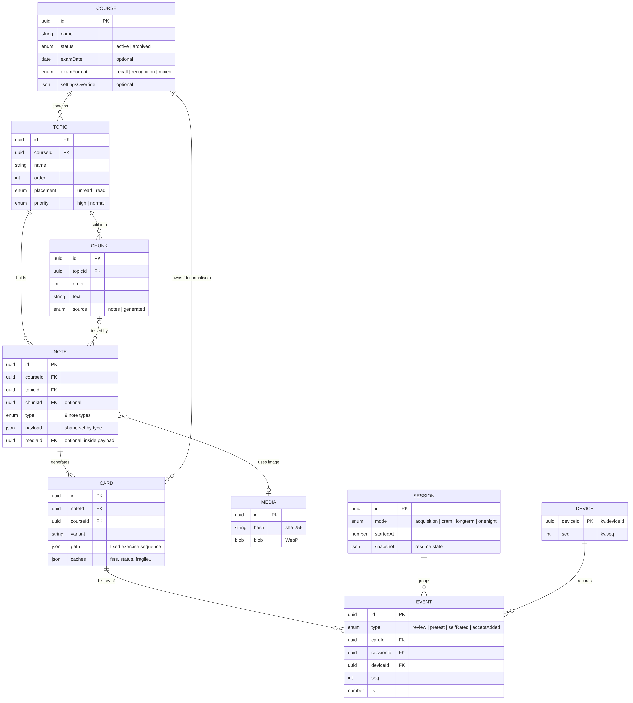
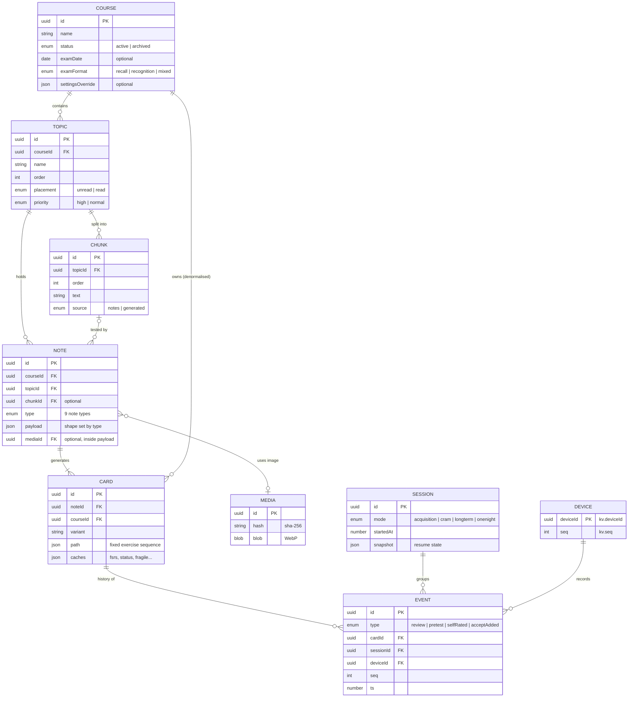

# Data Model — ER diagram and data dictionary

The single source of truth for every stored field. Code mirrors this file: each entity has a zod schema in `src/lib/db/schemas/<entity>.ts`, and its TypeScript type is `z.infer` of that schema. If code and this file disagree, fix one of them in the same commit.

**Legend for "Kind":**
- **content** — authored data, merged across devices by last-write-wins (`updatedAt`, then `deviceId`); deleted by tombstone (`deleted: true`).
- **cache** — derived; rebuilt by `replay()` from events. Never written anywhere else; never exported.
- **log** — append-only history; never edited or deleted (except archive/replace import of a whole course).
- **local** — device-only; never exported or merged.

---

## 1. ER diagram

Not shown: singleton key-value records (`kv`, §5) and the app log (`logs`, §6), which don't relate to other entities.

---

## 2. Common fields (`Meta`) — on every content record

| Field | Type | Req | Constraints | Meaning |
|---|---|---|---|---|
| `id` | `string` (UUID v4) | ✓ | `crypto.randomUUID()`, immutable | Globally unique ID |
| `createdAt` | `number` | ✓ | epoch ms, immutable | When created |
| `updatedAt` | `number` | ✓ | epoch ms; set by `repo.ts` on every write | LWW ordering |
| `deviceId` | `string` (UUID) | ✓ | the writing device | LWW tie-break |
| `deleted` | `true` | — | present only on tombstones | Soft delete |

---

## 3. Tables

### 3.1 `courses` — content

| Field | Type | Req | Constraints / allowed values | Meaning |
|---|---|---|---|---|
| *Meta* | | ✓ | §2 | |
| `name` | `string` | ✓ | 1–120 chars | Course name |
| `status` | `'active' \| 'archived'` | ✓ | | Archived = stub kept after archive export |
| `examDate` | `string` | — | `YYYY-MM-DD`, local | Exam day; enables cram/planner |
| `examTime` | `string` | — | `HH:mm`, local | Exam start; morning top-up ends before it |
| `examFormat` | `'recall' \| 'recognition' \| 'mixed'` | ✓ | default `mixed` | Chooses cram α (§6.6 plan) |
| `color` | `'lavender' \| 'peach' \| 'sage' \| 'sky' \| 'rose' \| 'butter'` | ✓ | assigned in order on creation; editable | Course colour (DESIGN §3.1) |
| `settingsOverride` | `Partial<Settings>` | — | keys from `kv.settings` | Per-course setting overrides (exercise toggles, spelling mode…) |

Indexes: `id, status, examDate, updatedAt`.

### 3.2 `topics` — content

| Field | Type | Req | Constraints | Meaning |
|---|---|---|---|---|
| *Meta* | | ✓ | | |
| `courseId` | `ID` | ✓ | → `courses.id` | Owning course |
| `name` | `string` | ✓ | from `@deck` | Topic name |
| `order` | `number` | ✓ | integer ≥ 0 | Position within course (import order) |
| `placement` | `'unread' \| 'read'` | ✓ | default `unread` | Routes cards to acquisition or review |
| `priority` | `'high' \| 'normal'` | ✓ | default `normal` | Topic-level priority |

Indexes: `id, courseId, [courseId+order], updatedAt`.

### 3.3 `chunks` — content

| Field | Type | Req | Constraints | Meaning |
|---|---|---|---|---|
| *Meta* | | ✓ | | |
| `topicId` | `ID` | ✓ | → `topics.id` | Owning topic |
| `order` | `number` | ✓ | integer ≥ 0 | Reading order |
| `text` | `string` | ✓ | from `@read` | What the student reads |
| `words` | `number` | ✓ | computed on write | For reading-time estimates |
| `source` | `'notes' \| 'generated'` | ✓ | `generated` if `[GENERATED]` | Shows the AI-generated banner |
| `check` | `true` | — | from `[CHECK]` | Had a `[CHECK]` marker; shown flagged |
| `splitFlag` | `true` | — | set by acquisition | Chunk quiz < 75%; re-check next day |
| `reported` | `true` | — | set by "report wrong" | Hidden from study until edited |

Indexes: `id, topicId, [topicId+order], updatedAt`.

### 3.4 `notes` — content

| Field | Type | Req | Constraints | Meaning |
|---|---|---|---|---|
| *Meta* | | ✓ | | |
| `courseId` | `ID` | ✓ | → `courses.id` | Denormalised for queries |
| `topicId` | `ID` | ✓ | → `topics.id` | Owning topic |
| `chunkId` | `ID` | — | → `chunks.id` | Set when imported after a `@read` |
| `order` | `number` | ✓ | integer ≥ 0 | Position within the topic (import order); IDs are random, so this keeps file order |
| `type` | `NoteType` | ✓ | §4.1 | Decides the payload shape |
| `payload` | `NotePayload` | ✓ | §4.2, must match `type` | The content |
| `priority` | `'high' \| 'normal'` | ✓ | from `@priority` | Planner value weight |
| `tags` | `string[]` | ✓ | may be empty | From `@tag` |
| `generated` | `boolean` | ✓ | | Came from a `[GENERATED]` chunk |
| `check` | `boolean` | ✓ | | Had a `[CHECK]` marker; shown flagged |
| `accept` | `Record<string, string[]>` | ✓ | key = card `variant`; may be empty | Grow-as-you-go accepted synonyms |

Indexes: `id, courseId, topicId, chunkId, type, updatedAt`.

### 3.5 `cards` — content (structure) + cache (scheduling)

| Field | Type | Req | Kind | Constraints | Meaning |
|---|---|---|---|---|---|
| *Meta* | | ✓ | content | | |
| `noteId` | `ID` | ✓ | content | → `notes.id` | Source note |
| `courseId` | `ID` | ✓ | content | → `courses.id` | Denormalised |
| `variant` | `string` | ✓ | content | §4.3; unique per note | Which part of the note this card tests |
| `path` | `ExerciseKind[]` | ✓ | content | ≥ 1; fixed per variant (plan §5) | Format sequence |
| `suspended` | `boolean` | ✓ | content | default `false` | Excluded from study |
| `fsrs` | `FsrsCardState \| null` | ✓ | cache | `null` until first credited review | ts-fsrs card state |
| `due` | `number` | — | cache | epoch ms | Next due time |
| `status` | `CardStatus` | ✓ | cache | §4.4 | Shown label |
| `fragile` | `boolean` | ✓ | cache | | Cram-fragile |
| `weak` | `boolean` | ✓ | cache | | Failed a relearn this session → cram gap 1 |
| `daysCorrect` | `number` | ✓ | cache | ≥ 0 | Distinct days correct since last lapse |
| `pathStep` | `number` | ✓ | cache | 0 ≤ n < `path.length` | Current position in `path` |
| `accuracy` | `{ n: number; correct: number }` | ✓ | cache | | First-attempt accuracy (for MC gating) |

Indexes: `id, noteId, courseId, status, due, updatedAt`.

### 3.6 `events` — log (discriminated union on `type`)

Common to all events:

| Field | Type | Req | Constraints | Meaning |
|---|---|---|---|---|
| `id` | `ID` | ✓ | UUID | Unique; merge key |
| `ts` | `number` | ✓ | epoch ms | When it happened |
| `deviceId` | `ID` | ✓ | | Recording device |
| `seq` | `number` | ✓ | per-device, strictly increasing | Ordering tie-break |
| `type` | `'review' \| 'pretest' \| 'selfRated' \| 'acceptAdded'` | ✓ | | Discriminant |

`type: 'review'` — every answer in a session:

| Field | Type | Req | Meaning |
|---|---|---|---|
| `cardId` | `ID` | ✓ | Card answered |
| `sessionId` | `ID` | ✓ | Session it happened in |
| `mode` | `Mode` | ✓ | §4.4 |
| `kind` | `ExerciseKind` | ✓ | Exercise used |
| `weight` | `'full' \| 'recognition' \| 'none'` | ✓ | From `kind` (plan §3.3) |
| `firstAttempt` | `boolean` | ✓ | First attempt after a (re)insertion; redo-till-right attempts are `false` |
| `correct` | `boolean` | ✓ | Verdict |
| `responseMs` | `number` | ✓ | Time to answer |
| `chosen` | `string` | — | The option picked / text typed (normalised) |
| `chosenFromCardId` | `ID` | — | If the wrong pick was another card's answer → confusion pair |
| `credited` | `boolean` | ✓ | `false` for same-day acquisition chunk-quiz answers (no FSRS/criterion credit) |

`type: 'pretest'`:

| Field | Type | Req | Meaning |
|---|---|---|---|
| `cardId` | `ID` | ✓ | Pretested card |
| `sessionId` | `ID` | ✓ | |
| `skipped` | `boolean` | ✓ | Student tapped skip |
| `responseMs` | `number` | ✓ | Time before reveal |

`type: 'selfRated'` — never affects scheduling:

| Field | Type | Req | Meaning |
|---|---|---|---|
| `noteId` | `ID` | ✓ | Note practised |
| `cardId` | `ID` | — | If tied to a card |
| `sessionId` | `ID` | ✓ | |
| `kind` | `'flip' \| 'explainIt' \| 'blurt' \| 'redraw' \| 'exampleStudy'` | ✓ | |
| `checked` | `string[]` | — | Checklist items ticked (explain-it / blurt) |
| `missedCardIds` | `ID[]` | — | Blurt triage: cards to bump in priority |
| `rating` | `'again' \| 'hard' \| 'good'` | — | Flip / redraw self-rating |

`type: 'acceptAdded'`:

| Field | Type | Req | Meaning |
|---|---|---|---|
| `noteId` | `ID` | ✓ | Note whose accept list grew |
| `variant` | `string` | ✓ | Answer key |
| `value` | `string` | ✓ | Normalised accepted string |
| `reviewEventId` | `ID` | — | The review re-judged as correct, if any |

Indexes: `id, ts, cardId, sessionId, type, [cardId+ts]`. **Order for replay:** `(ts, deviceId, seq)`.

### 3.7 `sessions` — local

| Field | Type | Req | Meaning |
|---|---|---|---|
| `id` | `ID` | ✓ | Referenced by events |
| `mode` | `Mode` | ✓ | |
| `courseIds` | `ID[]` | ✓ | Courses in scope |
| `startedAt` / `endedAt` | `number` | ✓ / — | |
| `plannedMinutes` | `number` | ✓ | From the planner |
| `phase` | `'warmup' \| 'new' \| 'recall' \| 'discrimination' \| 'cleanup'` | ✓ | Current phase |
| `snapshot` | `{ queue: CardId[]; counts: Record<CardId, number>; attempts: Record<CardId, number> }` | ✓ | Queue, per-card counts and attempt numbers (seeds derive from `(cardId, sessionId, attempt)`) — saved after every answer so a closed tab resumes |

Not exported (events keep `sessionId` for grouping).

### 3.8 `media` — content

| Field | Type | Req | Constraints | Meaning |
|---|---|---|---|---|
| *Meta* | | ✓ | | |
| `hash` | `string` | ✓ | SHA-256 hex of the WebP bytes | De-duplication |
| `mime` | `'image/webp'` | ✓ | | Re-encoded on import |
| `width` / `height` | `number` | ✓ | ≤ 1600 on long side | Pixels |
| `bytes` | `number` | ✓ | | Size, for storage display |
| `blob` | `Blob` | ✓ | | The image |
| `fileName` | `string` | — | | Original name (for `@occlusion` matching on import) |

Indexes: `id, hash`.

---

## 4. Types inside records

### 4.1 Note types and material types

| `NoteType` | Material (for `p0` defaults) | Created by |
|---|---|---|
| `keyterm` | fact | `@keyterms` |
| `fact` | fact | `@fact` |
| `cloze` | concept | `@cloze` |
| `sequence` | procedure | `@sequence` |
| `example` | procedure | `@example` |
| `compare` | comparison | `@compare` |
| `scenario` | comparison | `@scenario` |
| `diagram` | diagram | `@diagram stack \| flow` |
| `occlusion` | diagram | `@occlusion` / image editor |

### 4.2 Payloads (by `type`)

| Type | Payload shape |
|---|---|
| `keyterm` | `{ term: string; meaning: string }` |
| `fact` | `{ term: string; definition: string }` |
| `cloze` | `{ text: string }` — answers are the `{{…}}` spans, numbered c1, c2… in order |
| `sequence` | `{ name: string; steps: string[] }` (≥ 2) |
| `example` | `{ name: string; steps: { subgoal: string; step: string }[] }` (≥ 2) |
| `compare` | `{ items: string[]; rows: { attribute: string; values: string[] }[] }` — `values.length === items.length` |
| `scenario` | `{ situation: string; answer: string }` |
| `diagram` | `{ kind: 'stack' \| 'flow'; name: string; nodes: { id: ID; label: string; role?: string }[]; edges: { id: ID; from: ID; to: ID; label?: string }[]; layout?: Record<ID, { x: number; y: number }>; sourceMediaId?: ID }` — `stack` has no edges; edge endpoints must exist |
| `occlusion` | `{ mediaId: ID; boxes: { id: ID; x: number; y: number; w: number; h: number; label: string }[] }` — `x,y,w,h` are fractions in [0, 1] |

### 4.3 Card variants

| Note type | Variants |
|---|---|
| keyterm | `fwd` |
| fact | `fwd`, `rev` |
| cloze | `c1`, `c2`, … |
| sequence | `seq`, `step:<i>` |
| example | `ex` |
| compare | `row:<r>`, `cell:<r>:<c>`, `which:<r>` |
| scenario | `fwd` |
| diagram (stack) | `layers`, `layer:<nodeId>` |
| diagram (flow) | `node:<nodeId>`, `edge:<edgeId>`, `rebuild` |
| occlusion | `box:<boxId>` |

Variant strings are stable: editing a note keeps existing variants (and their card IDs) and only adds/removes the ones that changed.

### 4.4 Enums

| Enum | Values |
|---|---|
| `Mode` | `acquisition`, `cram`, `longterm`, `onenight` |
| `CardStatus` | `unseen`, `learning` ("New — retest tomorrow"), `needs-work`, `provisional`, `exam-ready`, `secure` ("Long-term secure"), `one-night` ("One-night triage") |
| `ExerciseKind` | `cloze`, `firstLetterType`, `fadeStep`, `newInstance`, `sequence`, `parsons`, `subgoalMatch`, `occlusionType`, `occlusionDrag`, `structureRebuild`, `layerOrder`, `nodeCloze`, `edgeCloze`, `categorize`, `oddOneOut`, `whichOne`, `scenario`, `tableRow`, `pickPrinciple`, `mc`, `multiSelect`, `occlusionBank`, `firstLetterBank`, `matching`, `hotspot`, `pretest`, `flip`, `explainIt`, `blurt`, `redraw`, `exampleStudy` |
| `Weight` | `full`, `recognition`, `none` (mapping in plan §3.3) |
| `Priority` | `high`, `normal` |
| `Placement` | `unread`, `read` |
| `ExamFormat` | `recall`, `recognition`, `mixed` |

### 4.5 `FsrsCardState`

The ts-fsrs `Card` object as stored by the library (due, stability, difficulty, elapsed/scheduled days, reps, lapses, state, last review). Stored verbatim; dates as epoch ms. Never edited outside `replay()`.

---

## 5. `kv` — singletons (key → value)

| Key | Value type | Kind | Meaning |
|---|---|---|---|
| `deviceId` | `ID` | local | Created on first launch |
| `seq` | `number` | local | Next event sequence number on this device |
| `schemaVersion` | `number` | local | Dexie migration version |
| `settings` | `Settings` | content | See below |
| `availability` | `Availability` | content | See below |
| `fsrsParams` | `{ version: number; params: number[]; optimisedAt: number }` | cache | Personal FSRS parameters |
| `calibration` | `{ secPerAttempt: Partial<Record<ExerciseKind, number>>; p0: Partial<Record<Material, number>> }` | cache | Rolling medians / measured accuracy; a missing key uses the default |
| `lastExportAt` | `number` | local | For the backup reminder |
| `offline` | `{ persisted: boolean; checkedAt: number }` | local | "Ready offline" status |

`Settings`:

| Field | Type | Default |
|---|---|---|
| `retention` | `number` (0.80–0.95) | 0.90 |
| `spellingMode` | `'fuzzy' \| 'firstLetter'` | `fuzzy` |
| `exercises` | `Partial<Record<ExerciseKind, boolean>>` | `{}`; a missing kind counts as `true`, so a new kind starts enabled |
| `occlusionMode` | `'hideOne' \| 'hideAll'` | `hideOne` |
| `acquisition` | `{ pretest: boolean; path: 'auto' \| 'full' \| 'quick'; deadlineOrder: 'breadth' \| 'depth' }` | `{ true, 'auto', 'breadth' }` |
| `theme` | `'system' \| 'light' \| 'dark' \| 'auto-night'` | `system` |
| `companion` | `'full' \| 'quiet' \| 'off'` | `full` |
| `companionName` | `string` | `Yuki` |
| `debugLogging` | `boolean` | `false` |

`Availability`:

| Field | Type | Meaning |
|---|---|---|
| `weekdayMinutes` | `number[7]` (Mon…Sun) | Default study minutes per weekday |
| `overrides` | `{ date: string; minutes: number }[]` | Per-date changes (`YYYY-MM-DD`) |
| `sleepWindow` | `{ start: 'HH:mm'; end: 'HH:mm' }` | No work planned inside it |
| `examMorningMinutes` | `number` | Top-up time before an exam |

---

## 6. `logs` — local (app log ring buffer)

| Field | Type | Req | Meaning |
|---|---|---|---|
| `seq` | `number` (auto-increment) | ✓ | Primary key |
| `ts` | `number` | ✓ | epoch ms |
| `level` | `'debug' \| 'info' \| 'warn' \| 'error'` | ✓ | |
| `area` | `string` | ✓ | e.g. `planner`, `session`, `import`, `replay`, `sw` |
| `message` | `string` | ✓ | Human-readable |
| `data` | JSON value | — | Structured detail (engine `trace`, counts, stack) |

Indexes: `++seq, ts, level, area`. Trimmed to `LOG_RING_SIZE` (2000). Exported only via "Export logs".

---

## 7. Export file (`.zip`)

`manifest.json`:

| Field | Type | Meaning |
|---|---|---|
| `formatVersion` | `1` | Bumped on breaking changes; importer migrates old versions |
| `appVersion` | `string` | |
| `exportedAt` | `number` | |
| `deviceId` | `ID` | |
| `scope` | `'all' \| { courseIds: ID[] }` | |
| `includesProgress` | `boolean` | |
| `counts` | `{ courses, topics, chunks, notes, cards, events, media }` | Shown in the import preview |

`data.json`: `{ courses, topics, chunks, notes, cards, events?, settings?, availability? }` — cards **without** cache fields; `events` only if `includesProgress`; `settings`/`availability` only if scope is `all`.

`media/<id>.webp`: one file per referenced image.

---

## 8. Derived data (computed, never stored as its own table)

| Data | Computed from | Used by |
|---|---|---|
| Confusion pairs | `review` events with `chosenFromCardId` | Distractor ranking, adjacent interleaving, contrastive feedback |
| Today's plan & forecast | Cards, events, courses, `availability` | Planner (re-plan each study day) |
| Retrievability at exam | `fsrs` cache + exam date | Cram triage, planner value |
| Calibration | `review` events | Workload estimates (cached in `kv.calibration`) |
